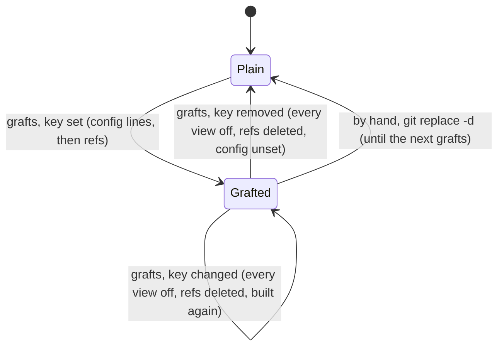
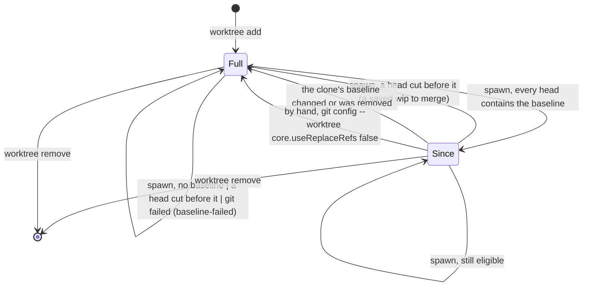

# baseline: module boundaries and the statecharts (#1099)

## Who may call whom

```
cli ── set ──────────────┐
spawn ── view ───────────┤
overlap::preview ─ grafts ┼──>  core::baseline  ──>  runner (git)  ──>  plain(): --no-replace-objects
diagram ── doc ──────────┘            │
                                      └──>  config (Fleet, Baseline), events (set only)
```

| Module | Owns | May call | Must not |
|---|---|---|---|
| `core::baseline` (new) | every `git replace`, `core.useReplaceRefs`, `drover.baseline`; `View`; the brief and workflow text | the runner, `config`, `events::emit` (in `set`), `lib`'s `set_in` and `write_atomic` (in `set`) | read an issue's state; refuse or delay a lane; fetch |
| `runner` | `plain`: the flag on every `git` | nothing new | know a fleet or a baseline |
| `hosts::On` | the ssh line | `runner::plain` before it quotes | add the flag itself |
| `config` | `Baseline`, `Fleet.baseline` | nothing new | run git (it checks the shape, not the history) |
| `spawn` | when a worktree's view is decided; the `baseline-failed` event; the brief line's place | `baseline::view` once per spawn, after the worktree exists and before the brief is written | make a graft, set the switch |
| `overlap::preview` | when the main clone's grafts catch up | `baseline::grafts` after its fetch, error ignored | anything else |
| `cli`, `hook` | the verb's parsing; owner-only | `baseline::set` | write fleet.toml themselves |
| `gate`, `land`, `update`, `drive`, `why`, `hotspots`, `lesson`, `check`, `design` | as today | git as today | know the baseline exists |
| server | nothing | nothing | call git for it (the request-path rule stands) |

Three `[[ban]]` lines (`adr.md`) hold the first two rows.

## A clone



## A lane worktree's view



`Full` is where every failure ends. There is no state in which a lane waits on the baseline.

## Order at spawn

1. `git fetch origin <base>` (as today).
2. `worktree add`, or the reopen (as today).
3. `baseline::view`: grafts for this clone, then this worktree's switch.
4. The brief is written, with the History line when the view is `Since`.

## Tests the boundaries ask for

- Runner: a real `git log` through the runner in a worktree with the switch on counts every commit (beside the
  runner-limits test).
- Real git, one temp clone with two worktrees, driving `spawn` with a fake shed:
  - a branch cut after the baseline: `git log --oneline | wc -l` equals the `rev-list --boundary` count;
    `git show <old sha>` exits 0; `git merge-base HEAD origin/<integration>` equals the `--no-replace-objects` one;
  - a branch cut before it: spawn prints the `cut before` line, its log counts everything, its `git merge` of
    integration succeeds;
  - an older branch merged with `--no-ff` after the baseline, then a fresh lane: still only the boundary count;
  - re-baseline, then the key removed: `git replace -l` is empty and both worktrees count everything.
- `drover why <file:line>` on a line older than the baseline, run in a `Since` worktree: names the real commit.
- Sim: the fixed seeds with `baseline` set in the scenario's fleet; the invariants unchanged.
