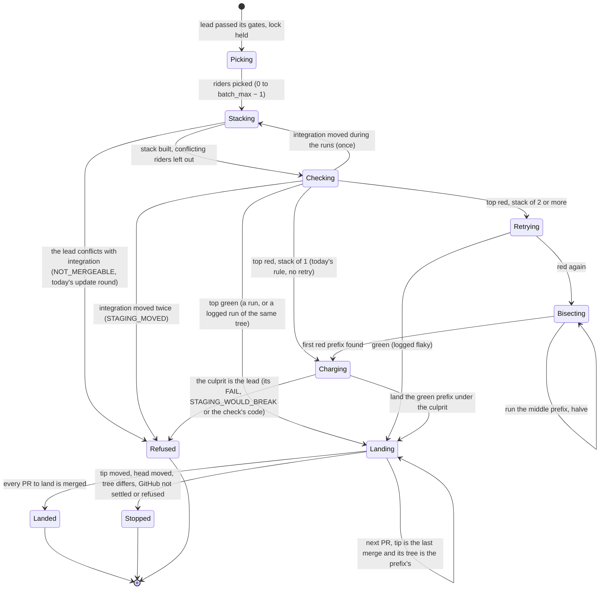

# batch-merge: boundaries and the statechart

## Who may call whom

```
 cli `drover merge` ─┐
 drive (its `merge` step, in the issue's job) ─┴─▶ gate::merge ─▶ batch::plan, batch::run
                                                                        │
            gate::{eligible, run_checks, premerge_checks, scratch, premerge_failed, land_one} ◀─┤
            queue::{replay, groups}   gh::strict   overlap::git   drive::job (renew the merge lease) ◀─┘

 land::auto_update ─▶ drive::job::merge_held      land::stats ─▶ batch::replay (pure, events only)
```

| Module | Owns | May call | Never |
|---|---|---|---|
| `gate.rs` | each gate at one head (`eligible`), the verdict a failed gate writes (`premerge_failed`), one PR's landing and its evidence (`land_one`: today's `gh pr merge`, `merged`, comment, follow-ups), the `merge` entry and its lock | `batch::plan`, `batch::run` | build a stack, loop over PRs |
| `batch.rs` (new) | the pick, the stack, the order of gate runs (retry, bisect), the order of landings, the three events | the `gate` functions above, `queue`, `gh::strict`, `overlap::git`, `drive::job` to renew the lease | push anything, start or prompt a lane, write a verdict but through `premerge_failed`, read or set an issue's state |
| `drive.rs` | when a merge step is due | `gate::merge` through `act`, as today | `batch` |
| `land.rs` | fast-first, `auto_update`, `stats` | `drive::job::merge_held`, `batch::replay` | `batch::run` |
| `config.rs` | `batch_max`, its two load errors, `batch_settle_secs` | | |

Two rules hold the shape, each with a ban in `.drover/arch.toml` (`adr.md`, last section):

- `gate::merge` is the one door to a merge. Nothing else calls `batch::run`, so every stack is built, checked
  and landed under the fleet's merge lock.
- `batch.rs` never pushes. A stack is local; every PR lands by its own merge pinned to its reviewed head.

`drive.rs` does not change. `auto_update` gains one early return: while the fleet's merge lock is held it pushes
nothing, so a catch-up never moves a head a batch is about to land.

## The lock and the job's time

- A batch runs in the lead's job, under `merge-<fleet>.lock`, as one merge does today.
- `check` renews the lease to `gate_check_minutes` before each gate run, and `land` before each merge.
- `drive::job::limit` gives a job holding the merge lease until that lease expires, in place of one fixed
  `gate_check_minutes`. A hung run still ends within `gate_check_minutes`; a bisect is not cut short.
- The merge promise's deadline (`promise.rs`) for a fleet with `batch_max > 1` covers the worst case:
  `gate_check_minutes × (3 + ⌈log2 batch_max⌉)`.

## The batch's statechart

One call of `drover merge` walks it from top to a final state. Nothing is kept between calls but the logged
runs.



| Final state | The lead | A rider | Logged |
|---|---|---|---|
| Landed, all | merged | merged | `merged` each, `batch-landed landed` (or `flaky`) |
| Landed, a rider charged | merged | under the culprit: merged. The culprit: FAIL, fix round. After it: still `ready` | `batch-landed charged` |
| Refused, the lead charged | FAIL, fix round, as today | still `ready` | `batch-landed charged`, nothing landed |
| Refused, conflict or moved | today's refusal | still `ready` | nothing new |
| Stopped | merged, or the stop's refusal when it stopped on the lead | landed before the stop: merged. The rest: still `ready` | `batch-landed stopped` with `why` |

Every final state leaves each PR either merged with its evidence or exactly as it was, plus at most one
charged culprit. So the next merge step of any `ready` PR starts a new batch with no clean-up.

## An issue's states

Unchanged. `ready → merged` is still one `merged` event per issue; `ready → fix` for a culprit is still a drive
`verdict FAIL`. `crates/core/flow/issue/ready.toml` keeps its `merge` row (`to = ["merged", "fix"]`).
