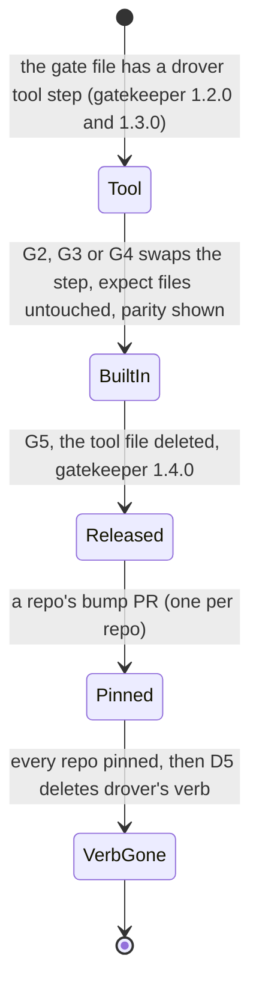
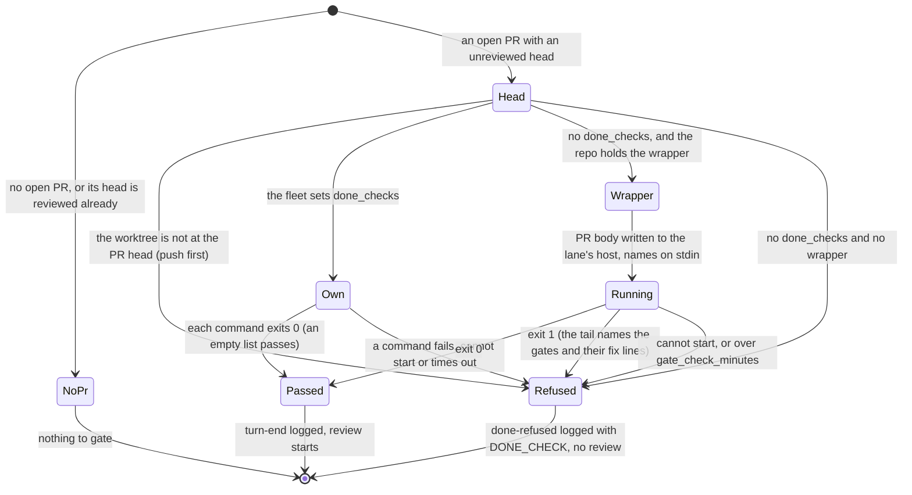

# The 5 checks in gatekeeper: module boundaries and statecharts (#1643)

## Where the code goes

```
gatekeeper
  crates/gatekeeper-model/src/names.rs       PrivateNames, the rules report's types
  crates/gatekeeper-engine/src/check/
    cap.rs  rules.rs  hygiene.rs  pr_body.rs   one file a check (collected; mod.rs is generated)
    arch.rs                                    the entry: reads arch.toml, calls the parts, joins the findings
  crates/gatekeeper-engine/src/arch/           arch's parts, each under 400 lines (collected)
    config.rs  layers.rs  bans.rs  sizes.rs  frozen.rs  generated.rs  comments.rs  docs.rs  baseline.rs
  crates/gatekeeper/src/cmd/check.rs           reads the two env vars once, fills RunCtx
  crates/gatekeeper/src/cmd/fixture.rs         new verb: writes one fixture case's files to a folder (G3)
  packs/core/gates/{cap,rules,arch,hygiene,pr-body}.toml    step: check = "<name>"
  packs/core/fixtures/<gate>/<case>/           today's cases, plus drover's tests as new cases
  packs/core/fixtures/hygiene/shared-names/    the shared names set, its home from G3 on
  packs/core/tools/drover.toml                 deleted (G5)

drover
  crates/core/src/gatekeeper.rs                new: the wrapper's command line, the rules report (D3, D4)
  crates/core/src/done.rs                      the done gate: head pushed, then gatekeeper::check
  crates/core/src/gate.rs                      the merge check: gatekeeper::check with gate core/cap
  crates/core/src/lesson.rs                    record, review, apply: read gatekeeper::rules
  crates/core/src/hygiene.rs                   the pre-send guard with its name matcher, scan, push (no gate verb)
  crates/cli/tests/golden/private-names/       the shared names set: written by D1, generated from the pin by D2
  crates/core/src/overlap.rs                   the cap view (no check verb)
  crates/core/src/hotspots.rs                  reads three list keys of arch.toml itself
  crates/core/src/arch.rs                      deleted (D5)
  crates/cli/tests/docs_cli.rs                 new: every `drover …` span in the docs is a real command (D2)
```

## Who may call whom

| Module | May use | Never |
|---|---|---|
| gatekeeper `check/<name>.rs` | the model, `CheckCx`, the engine's runner for git and for a repo's own command (`generate`, a lesson check) | the environment; the network; the fleet config; a drover binary |
| gatekeeper `arch/*.rs` | the model, files under the repo root | another check's file |
| gatekeeper cli | the engine; the environment, read once into typed values | printing a name from the list |
| gatekeeper `packs/core/gates/*.toml` | `check` steps, the pinned actionlint | a `tool` step or a `{tool:…}` naming drover |
| drover `gatekeeper.rs` | `On` (write a file, run a command with stdin and a time limit, read a file) | deciding what a check means: it returns the exit code and the tail |
| drover `done.rs`, `gate.rs`, `lesson.rs`, `setup.rs` | `gatekeeper.rs` | the wrapper's path; a file under gatekeeper's output folder |
| drover `hygiene.rs` | the fleet config, the event log, `gh`, git | the gate: it holds no `check` verb |
| a lane, on any host | `./.gatekeeper/run check` | the five drover verbs (deleted in D5) |

Rules that follow, each with its enforcer:

- **No gate calls drover.** Enforcer: two bans in gatekeeper's `arch.toml` (G5), and the deleted tool file, which
  makes a config that names the tool a load error.
- **A check reads no environment.** Enforcer: gatekeeper's existing ban on `env::var` in the engine and the model.
- **A name is never printed.** Enforcer: `PrivateNames` has no `Debug`, `Display` or `Serialize`; a hit is a
  number. G1 adds the test that a failing hygiene case's log holds no name.
- **Same findings.** Enforcer: review of G2 to G4 against "no `expect` file edited"; selftest fails a gate whose
  case prints something else.
- **A private name matches the same in both repos.** Enforcer: the shared names set. Gatekeeper's selftest fails
  unless `core/hygiene` prints the set's `expect` lines (G3). Drover's test fails unless the guard gives the same
  lines (D1). Drover's copy is a generated file from D2 on, so `core/arch` fails a copy that is not the pinned
  release's.
- **One module in drover names gatekeeper.** Enforcer: the ban in drover's `arch.toml` (`adr.md`, last section).
- **A lane verb needs no fleet config for the done gate.** Enforcer: D3's test, which runs the gate against a lane
  host with no config; #1646's wider test covers the other verbs.
- **Docs name real commands.** Enforcer: the new test in drover (was arch-check's `cli` key).

## A check's move



Between `Tool` and `Pinned` a repo runs whichever of the two its pin names, and both read the same files and the
same env var. No state runs neither.

## `turn done`'s gate



This is the gate after D5: one refusal code is left, `DONE_CHECK`. From D3 until D5, drover's own PR body check
(`PR_BODY`) still runs before `Wrapper`, as today. The three-refusals card and the idle nudge do not change.

## `core/hygiene`: which runs check, which skip

| Run | The list | Result |
|---|---|---|
| CI, a private repo | not read | skipped: private repo (as today) |
| CI, a fork's pull request | no secret there | skipped; it runs on the merge push (as today) |
| CI, the repo's own run, public | the `private-names` secret | checked; no secret: `list-missing`, a failure (as today) |
| CI, public, with `[off]` for this gate | | the plan refuses the config (new, G3) |
| A lane's host, public repo | `DROVER_PRIVATE_NAMES`, from the done gate or the pane (#1642) | checked; unset: `list-missing` |
| A lane's host, private repo | none | off by the repo's `[off]` line, with its reason printed |

## A lesson check's life

```mermaid
stateDiagram-v2
    [*] --> Shadow: a lesson PR adds the rule line (shadow since)
    Shadow --> Shadow: gatekeeper runs it, reports would-fail, never fails; drover logs lesson-shadow at each merge
    Shadow --> Active: lesson apply promotes it (active since)
    Shadow --> Retired: lesson apply deletes the line
    Active --> Active: gatekeeper runs it and fails the gate on a hit
    Active --> Retired: the owner's retire line, then lesson apply
    Retired --> [*]
```

Gatekeeper owns the self-loops (running, reporting). Drover's lesson lane owns the three arrows between states.
