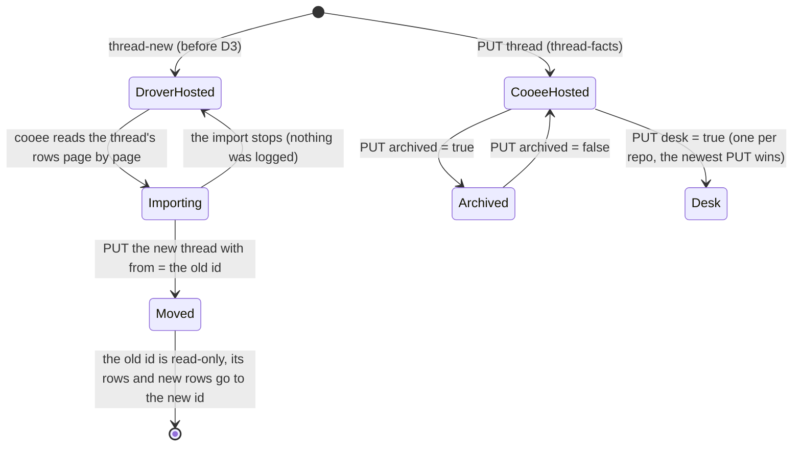
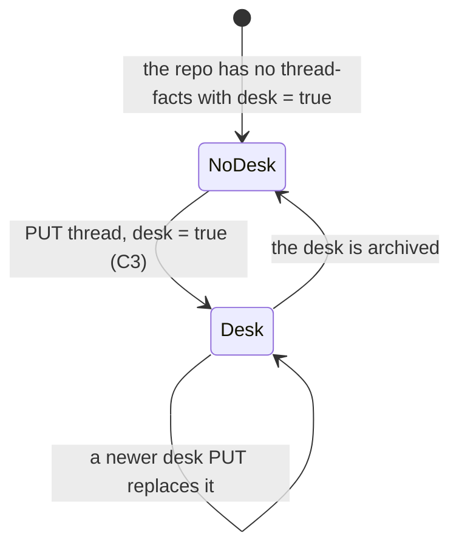
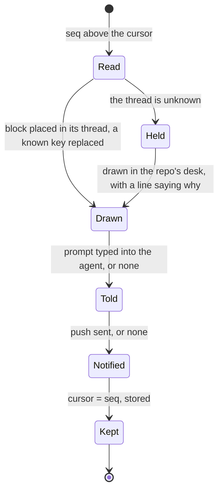

# cooee-threads: module boundaries and statecharts (#1571)

## Who may call whom

```
cooee ──HTTP, plugin token──▶ server::serve::rows   (GET rows, rows/stream, thread/<id>/rows; PUT thread; POST said)
cooee ──POST /action────────▶ server::screens ─────▶ server::serve::rows::action ──▶ the core verb (answer, card, …)
drover's page ──────────────▶ server::serve::chat   (its own thread screens, drawn from rows)
drover chat, thread show|ls ─┐
                             ▼
                 core::thread          registry (facts), rows(), list(), say(), said(), unread
                 core::thread::route   home(), emit(); lane_ask, to_owner, flow, handoff, tell
                 core::orchestrator    who acts (acting, actor, by), the role, the brief, the profiles
                             ▲
core::{lib (ask, answer), card, propose, secret, triage, check, gate} ── emit a row through thread::route
```

| Module | Owns | May call | Must not |
|---|---|---|---|
| `server::serve::rows` (new) | the routes above; a core row plus its block; the stream; the thread actions' table | `core::thread`, `serve::chat`'s block builders, the hub | decide where a row goes; start, stop or type into an agent |
| `server::serve::chat` | drover's own thread screens and the `chat` tab, from rows | `core::thread`, `screens_kit` | read `orchestrator-start` to decide a state; upload, queue or pick a model |
| `core::thread` (new) | the thread registry from `thread-facts`; `Row` without its block; `say`, `said`; unread and read marks | `events`, `config` | import blocks; call `term`, `shed`, `spawn`, `session` or `providers` |
| `core::thread::route` (new) | `home`: a thread id or a repo's desk; the emitters every workflow verb uses | `core::thread`, `events`, `config`; until D4, the engine's `deliver` for a thread drover hosts | deliver to a cooee thread: there a row's `prompt` is the only way a line reaches an agent |
| `core::orchestrator` (kept, about 300 lines) | the acting orchestrator, the role and its `[config]` sheet, `brief`, `chat::profiles` | `config`, `providers` (the ACP agent name, the settings path), `spawn::unguarded` | hold a thread, a message or a session |
| `core::events::notify` | `[[notify]]` command notifiers | the runner | send a web push; decide a row's `push` (that is `thread::route`) |
| `chat` (the terminal) | the Threads tab from `thread::list` and `thread::rows`; answers and card taps through the core verbs | `core::thread`, `core::card`, core's answer | deliver, check shed, or wait on an agent |
| cooee | the thread, messages, uploads, picks, the agent, the desk thread, push | drover's routes in `[threads]`, `/action`, `/cooee/profiles` | read a row's `kind` to decide workflow; name a drover path or event outside the manifest |

Nothing in drover calls cooee. The bans in [adr.md](adr.md) hold the last column where a pattern can.

## Migration (the system)

```mermaid
stateDiagram-v2
    [*] --> Frozen: today, drover's thread chat takes fixes only
    Frozen --> Contract: D1 merged (rows served, keys frozen)
    Contract --> OrchestratorFirst: #1609 merged (cards by thread id, judgment, quiet decisions, digest)
    OrchestratorFirst --> BothHosts: C1 and D2 live (cooee draws rows, types prompts, pushes; drover copies said)
    BothHosts --> Routed: C2 and C3 live (repo per thread, each desk PUT turns the desk fallback on)
    Routed --> PushMoved: the owner's config card drops the webpush notifier
    PushMoved --> Moving: C6 live (import)
    Moving --> Moved: no drover-hosted thread is open, D3 merged (new ones refused)
    Moved --> Cut: D4 merged
    Cut --> [*]
```



Each arrow is a merge or an owner card, and each state runs. Up to `Moved` nothing is deleted and drover's surfaces
are as today. In `OrchestratorFirst` and `BothHosts` a card goes orchestrator first only in a thread drover hosts; one
filed from a cooee chat, or from no thread, is an owner card until `Routed`. Before `Cut`, going back is turning
cooee's row reader off: drover's own threads carry on.

One sender at a time: while fleet.toml has a `type = "webpush"` notifier, drover sends as today and every row's `push`
is null. The config card that removes the notifier is the switch to cooee; D4 then deletes the notifier type.

## A thread's host



How history moves: it is never copied out of drover's log and never deleted. Cooee's import reads a thread's rows
oldest first, adds each as a history item with its time (messages as messages, a settled card as its block, no
prompt, no push), then `PUT`s the new thread with `from`. From that seq on, `home` and every open row of the old
thread name the new id, so open asks and cards appear there through the normal row stream. A drover-hosted thread
whose agent is awake is put to sleep by drover first (its last engine act); the cooee thread starts a fresh agent
session with the imported text as context, since the two engines keep sessions differently. Running the import
twice finds the `from` link and does nothing.

`Archived` and `none` threads take no routed rows: `home` falls through to the repo's desk. So does a thread
drover neither hosts nor has had `PUT`: a cooee chat opened before C2.

## A repo's desk, on drover's side



`NoDesk`: a `to: desk` row is an owner card as today (open, pushed, on the board, no `prompt`), and the board does
not say `with orchestrator`. `Desk`: the row carries its `prompt`, and the orchestrator there judges it first
(#1609). The state is read from the log at the row's seq, so a replay gives the same row. A card left open from
`NoDesk` shows in the desk once it exists and stays the owner's to answer.

## A row, on cooee's side



A row is never dropped: a thread cooee does not have falls to the desk. Drover sees the reader's cursor on each
`GET rows` and on the stream's reconnect; past `rows_stale_minutes` behind a row with `push`, `check` says so on the
board and through the `[[notify]]` commands, which is how an owner card is not lost while cooee is down. The lifeboat
page answers asks and run cards without cooee, as today.
