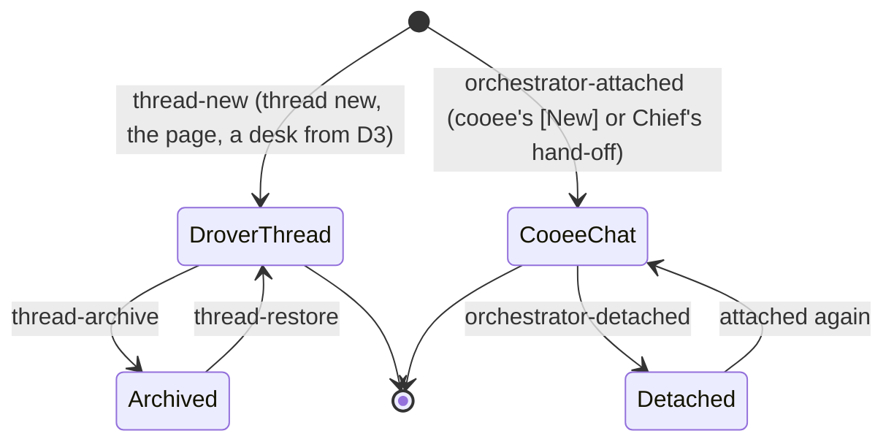
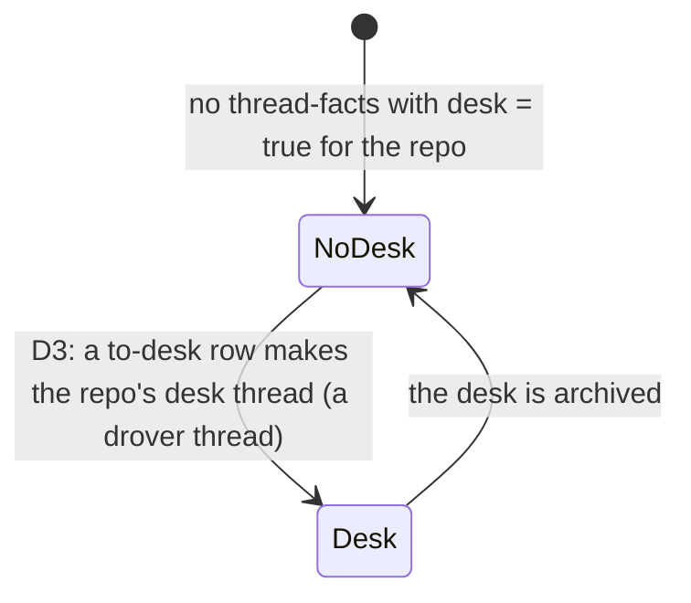
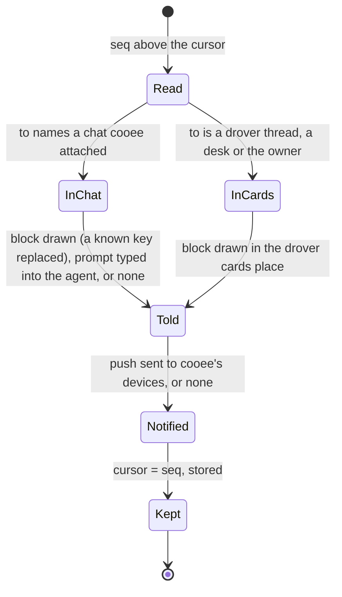

# cooee-threads: module boundaries and statecharts (#1571)

## Who may call whom

```
cooee ──HTTP, plugin token──▶ server::serve::rows   (GET rows, rows/stream, thread/<id>/rows; POST said)
cooee ──HTTP, plugin token──▶ server::serve::v1     (orchestrator-attach, -detach: as today, via #1663 later)
cooee ──POST /action────────▶ server::screens ─────▶ server::serve::rows::action ──▶ the core verb (answer, card, …)
drover's page ──────────────▶ server::serve::chat   (its own thread screens, as today)
drover chat, thread show|ls|say ─┐
                                 ▼
                 core::thread          registry (both hosts), rows(), home()
                 core::thread::route   emit(): log the row; deliver its prompt only to a drover thread
                 core::orchestrator    who acts, the role, the brief, the profiles, the engine for drover threads
                                 ▲
core::{lib (ask, answer), card, propose, secret, triage, check, gate} ── emit a row through thread::route
```

| Module | Owns | May call | Must not |
|---|---|---|---|
| `server::serve::rows` | the rows routes, `said` (D2), a core row plus its block, the stream, the thread actions' table | `core::thread`, `serve::chat`'s block builders, the hub | decide where a row goes; start, stop or type into an agent |
| `server::serve::chat` | drover's own thread screens and the `chat` tab, as today | `core::thread`, `core::orchestrator`, `screens_kit` | list a cooee chat's conversation (drover does not hold it) |
| `core::thread` | the registry (drover threads, cooee chats, desks); `Row` without its block; `home` | `events`, `config` | import blocks; call `term`, `shed`, `spawn`, `session` or `providers` |
| `core::thread::route` | the emitters every workflow verb uses | `core::thread`, `events`, `config`, the engine's `deliver` for a drover thread | deliver to a cooee chat: there a row's `prompt` is the only way a line reaches the agent |
| `core::orchestrator` | the acting orchestrator, the role and its sheet, `brief`, the profiles, attach and detach, and the engine (start, deliver, sleep, hold) for drover threads | `config`, `providers`, `spawn::unguarded`, shed | start or type into a session for a thread whose open event is `orchestrator-attached` (D2) |
| `core::events::notify`, `core::webpush` | `[[notify]]` notifiers and web push to devices subscribed on drover's page, as today | the runner | read cooee's subscriptions |
| `chat` (the terminal) | the Threads tab, as today | `core::thread`, `core::orchestrator`, `core::card`, core's answer | |
| cooee | its chats, their messages, uploads and picks, its Orchestrator agent, Chief's hand-off, its devices and push | the routes in `[threads]`, `/action`, `/cooee/profiles` | read a row's `kind` to decide workflow; name a drover path or event outside the manifest |

Nothing in drover calls cooee. The bans in [adr.md](adr.md) hold the last column where a pattern can.

## Migration (the system)

```mermaid
stateDiagram-v2
    [*] --> Contract: D1 merged (#1617: rows served, keys frozen)
    Contract --> OrchestratorFirst: #1609 merged (cards by thread id, judgment, quiet decisions, digest)
    OrchestratorFirst --> Clients: D2 merged (no delivery into a cooee chat, said, push on rows, [threads])
    Clients --> Desks: D3 merged (a drover desk thread per repo, [chat])
    Desks --> Handoffs: #1610 merged (handoffs to the desk, [move])
    Handoffs --> CapRaises: #1608 merged
    Clients --> Reading: C1 live (cooee draws rows, types prompts, sends push)
    Reading --> CooeeOrchestrator: cooee #802 live (Chief hands off; [New] picks a repo and attaches)
    CapRaises --> [*]
    CooeeOrchestrator --> [*]
```



Each arrow is a merge or a release, and each state runs. Nothing in drover is deleted on the way, and drover's page,
terminal and `drover chat` stay as today throughout. The drover line and the cooee line run side by side after D2.
Going back on the cooee side is cooee no longer attaching or reading rows: drover's threads carry on, and a chat's
open cards are still on drover's board.

Push has no switch. Drover's web push keeps sending to devices subscribed on its page. From D2 every row carries
`push`, and cooee sends it to devices subscribed in cooee. A device is subscribed to one of them.

## A thread's host



A thread never changes host. In `DroverThread` drover runs the agent and delivers every row's `prompt`. In
`CooeeChat` cooee runs the agent and types the `prompt` in; drover delivers nothing (D2). `Archived` and `Detached`
take no routed rows, and `home` falls through to the repo's desk.

History does not move. A drover thread's history stays in drover's log and on drover's surfaces. A cooee chat starts
at its attach, and cooee may read its earlier rows through `thread/<id>/rows`. Nothing is copied out of the log, and
nothing is deleted.

## A repo's desk



`NoDesk`: a `to: desk` row is an owner card as today (open, pushed, on the board, no `prompt`). `Desk`: the row
carries its `prompt`, drover delivers it, and the orchestrator there judges it first (#1609). The state is read from
the log at the row's seq, so a replay gives the same row. Cooee draws desk rows in its drover cards place, where
[chat] and [move] post the same actions as on drover's page.

## A row, on cooee's side



A row is never dropped. With cooee down, rows wait in the log and the stream resumes from `Last-Event-ID`.
