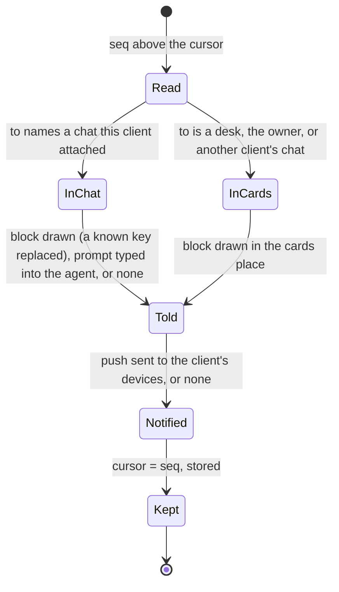

# cooee-threads: module boundaries and statecharts (#1571)

## Who may call whom (after D4)

```
a client ──HTTP, plugin token──▶ server::serve::v1     (manifest, orchestrator-attach, -detach)
a client ──HTTP, plugin token──▶ server::serve::rows   (rows, rows/stream, thread/<id>/rows; POST said)
a client, drover's page ─POST /action─▶ server::screens ──▶ serve::rows::action ──▶ the core verb (answer, card, …)
drover's page, drover board ───▶ server::serve::cards, chat::board  (the owner cards, drawn from rows)
drover orchestrator attach ────▶ core::orchestrator::attach   (a terminal session's chat)
                                 ▼
                 core::thread          registry (attached chats, old threads as history), rows(), home()
                 core::thread::route   emit(): log the row; never deliver into a chat
                 core::orchestrator    who acts, the role, the brief, the profiles, attach and detach
                 core::judge           which open ask or card needs a judge; its brief and its end (#1609)
                                 ▲
core::{lib (ask, answer), card, propose, secret, triage, check, gate} ── emit a row through thread::route
core::drive ──▶ core::judge::due ──▶ core::spawn (role judge, no worktree)
```

| Module | Owns | May call | Must not |
|---|---|---|---|
| `server::serve::rows` | the rows routes, `said`, a core row plus its block, the stream, the actions' table | `core::thread`, `serve::cards`, the hub | decide where a row goes; start, stop or type into an agent |
| `server::serve::cards` (from `serve/chat.rs`, D4) | the block builders of asks and cards: options recommended first, the note field | `core::thread`, `screens_kit` | hold a conversation |
| `server::serve::v1` | the manifest (D5), attach and detach | `core::orchestrator` | call a client |
| `core::thread` | the registry, `Row` without its block, `home` | `events`, `config` | import blocks; call `term`, `shed`, `spawn`, `session` or `providers` |
| `core::thread::route` | the emitters every workflow verb uses | `core::thread`, `events`, `config` | deliver into any session: a row's `prompt` is the only way a line reaches a chat |
| `core::orchestrator` | the acting orchestrator, the role and its sheet, `brief`, the profiles, attach and detach | `config`, `providers` | start, stop or type into a session (D4 deletes the engine) |
| `core::judge` (#1609) | `due`: open asks and needs-human cards with no judge; the judge brief; `judge-failed` | `events`, `config`, `thread::route::to_owner` | answer for itself: the lane answers through the CLI |
| `core::events::notify`, `core::webpush` | `[[notify]]` and web push to devices subscribed on drover's page | the runner | read a client's subscriptions |
| `chat` (the terminal) | the Board tab only, run by `drover board` | `core::thread`, `core::card`, core's answer | keep a Threads tab |
| a client | its chats, their messages, uploads and picks, its Orchestrator agent, its devices and push | the manifest's paths, `/action` | read a row's `kind` to decide workflow; hold a path the manifest does not give |

Nothing in drover calls a client. The bans in [adr.md](adr.md) hold the last column where a pattern can.

## Migration (the system)

```mermaid
stateDiagram-v2
    [*] --> Contract: D1 merged (#1617: rows served, keys frozen)
    Contract --> Judged: #1609 merged (judge lanes, quiet decisions, digest, routing by thread id)
    Judged --> Clients: D2 merged (no delivery into an attached chat, said, push on rows, orchestrator attach)
    Clients --> Handoffs: #1610 merged (handoffs to desk rows, [move], land gone)
    Clients --> Reading: C1 released (cooee draws rows, types prompts, sends push)
    Reading --> CooeeOrchestrator: cooee #802 released (Chief hands off; [New] attaches or adopts)
    Handoffs --> Frozen: D3 merged, after C1 (no new thread; closing rows; attach adopts old ids)
    CooeeOrchestrator --> Frozen
    Frozen --> Cut: D4 merged (threads stopped and archived; store, engine, screens, drover chat deleted)
    Cut --> Manifest: D5 merged (manifest served; cooee-plugin.toml generated)
    Manifest --> CapRaises: #1608 merged
    CapRaises --> [*]
```

Each arrow is a merge or a release, and each state runs. Until D3 drover's threads work as today, and from #1609
the judge answers a lane ask even when no thread is open. D3 waits for C1, so the owner has a chat in a client before
drover stops taking new threads. D5 and #1608 need only D2 and #1609; they are drawn last for one line.

Going back: before D4, reverting D3 reopens `thread new`. After D4 the way back is a revert of D4's merge; the log
still holds every thread event, so a restored engine reads them as before.

## An open drover thread, through D3 and D4

```mermaid
stateDiagram-v2
    [*] --> Live: thread-new before D3
    Live --> Frozen: D3 merged
    Frozen --> Closing: D3's first drive pass logs its closing row (once)
    Closing --> Adopted: a client attaches its id (cooee [New] adopt, or drover orchestrator attach --thread)
    Closing --> Stopped: D4's first drive pass (its session ended, thread-archive by migration)
    Adopted --> [*]: an attached chat; its issues route to it
    Stopped --> Adopted: a client attaches its id later
    Stopped --> [*]: history only
```



- `Frozen`: the thread still runs, so in-flight work finishes; `thread new` and [New] are refused `THREADS_CUT`; a
  lane ask goes to the judge, never to a thread.
- `Closing`: a `system` row with `closing: true`: "drover threads end with D4; attach `<id>` in a client to carry on;
  history stays readable". Its open asks and cards stay open and are on the board, as every open card is.
- `Stopped`: D4's pass ends the thread's session once and logs `thread-archive` with `by: migration`. It is
  idempotent: an archived thread is skipped.
- History never moves. `GET /api/v1/thread/<id>/rows` serves an old thread's rows from the log, so a client that
  adopts it can draw them. The uploads folder stays on disk; deleting it is an owner run card.

## A judge (#1609)

```mermaid
stateDiagram-v2
    [*] --> Due: an open lane ask, or a needs-human card, with no judge spawn for it
    Due --> Waiting: judge_max busy, or the host refuses the spawn
    Waiting --> Due: next drive pass
    Due --> Running: spawn role judge (action_id judge:<fleet>:<id>)
    Running --> Answered: drover answer --basis, or extend --basis
    Running --> ToOwner: drover answer with no basis (OWNER_ASK files it)
    Running --> Failed: lane dead, judge_minutes passed, or refused
    Failed --> ToOwner: judge-failed; to_owner with why
    Answered --> [*]: quiet decision row, [change] for the window, in the digest
    ToOwner --> [*]: owner card, pushed; a routine one still defaults after ask_default_minutes
```



A judge is spawned once per `Judged` value: a second pass finds its `spawn` and skips it. The owner answering first
ends it: the judge's `answer` is `ALREADY_ANSWERED`, and it exits.

## A row, on a client's side



A row is never dropped. With a client down, rows wait in the log and the stream resumes from `Last-Event-ID`;
drover's board, TUI and page draw every open row meanwhile.
