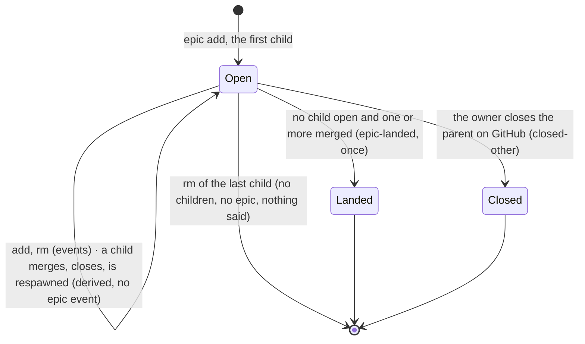
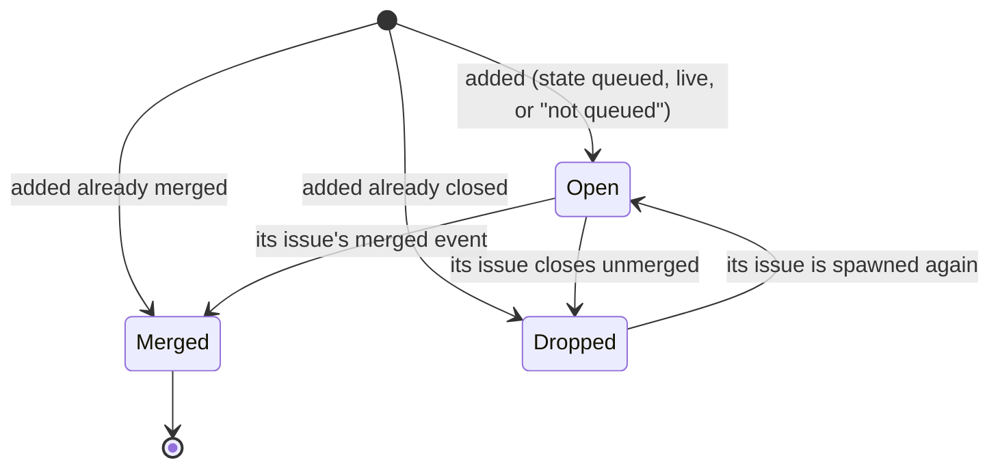

# Boundaries and statecharts

## The module (`epic.rs` in core)

| Function | Pure | What |
|---|---|---|
| `replay(events, fleet) -> Members` | yes | the `epic` events folded: `add` inserts, `rm` removes, an empty parent drops out |
| `open(ctx, events, states, fleet) -> Vec<Epic>` | reads the title cache | each parent with no done state, its children classed by their own states |
| `parent_of(events, states, fleet, n) -> Option<u64>` | yes | the open epic `n` is a child of |
| `is_parent(events, states, fleet, n) -> bool` | yes | `n` is an open epic's parent |
| `check(events, states, fleet, parent, &Op) -> Result<()>` | yes | the refusals of `shapes.md` that need no GitHub read |
| `change(ctx, cfg, r, fleet, parent, Op) -> Result<String>` | no | `check`, one spec read per new issue (open, not a PR; it also caches the title), then the `epic` event; returns the line the CLI prints |
| `watched(events, states, fleet) -> Vec<u64>` | yes | open epics' parents and children that have no state: GitHub is asked whether they closed |
| `settle(ctx, cfg, r, out, fleet) -> Result<()>` | no | lands every open epic whose `lands()` is true |
| `summary(&Landed) -> String` | yes | the comment's body, also the row block's lines |

## Who may call whom

| Module | May call | Never |
|---|---|---|
| `epic` | `events` (read, fold, `emit`, the new `emit_once`), `queue::replay` (is a child queued), `gh` (spec, cached title), `hygiene::args`, the runner for `gh issue comment` and `gh issue close` | `spawn`, `drive`, `gate`, `waiting`, `thread`: an epic starts nothing and decides nothing about a lane |
| `cli` | `epic::change` for the verb; `epic::check`, then the queue event, then `epic::change` for `queue add --epic`; `epic::is_parent` to refuse `queue add` of a parent | |
| `spawn::plan` | `epic::is_parent` (beside its `MERGED` refusal) | |
| `gate::merged` | `epic::settle`, last, after the issue's own comment and close; its error is printed, never returned | reading epic membership itself |
| `drive` (the fleet step, beside the blocker check) | `epic::settle` | |
| `check::closed_on_github` | `epic::watched`, added to the issues it asks GitHub about | |
| `events` | nothing in `epic`: the fold's two arms and `plain`'s one read only the event; `emit_once(state, cfg, action_id, ev) -> Result<bool>` is `emit` with its append under `db::claim` | `epic::…` |
| `thread` | nothing in `epic`: `epic-landed` is a `merged` row by its kind, keyed by fleet and parent; `Registry::add` homes a parent on its first `epic` `add` | |
| `webpush` | nothing in `epic`: one title arm | |
| `waiting` (the CLI's printing), `queue::board` | `epic::open`, `Epic::line` | building their own count |
| `hook` | nothing: it matches the `epic` verb and the `--epic` flag | |
| server `api` / `serve` | `epic::open` for `QueueCard.epics`; `rows::view` copies the event's `Landed` into `RowView.epic`; `chat::drawn` adds `epic::summary` under the landed row's text | |
| server `screens_epics.rs` (new) | `QueueCard.epics`, the screens kit, `screens::row` for an open child | `json!` (the #1342 ban, extended to it); core's `epic` directly |
| `screens::fleet_card` | `screens_epics::section`, put first in the card | |
| `chat` crate (terminal Board), `web/` | nothing new: both draw the section from the kinds they know | any epic code |

Enforced by: the layer check (core never calls server), the two `[[ban]]` lines on `epic.rs` and the extended
`json!` ban ([adr.md](adr.md), last section), and the screens vocabulary test for "no new block key".

## An epic

- `Open` is not stored. It is "the list has children and the parent has no done state", read on every view.
- With every child dropped and none merged, the epic stays `Open` and shows `0/0 merged · 3 dropped`. Drover does
  not close a feature of which nothing landed; the owner closes it, or adds a child.
- `Closed` says nothing: no comment, no row, no push. The owner did it.
- After `Landed` or `Closed` the parent is a done issue. `epic add` on it refuses `EPIC_PARENT`.

## A child, as its epic sees it

No arrow here is an epic event: each is the child issue's own state change, which drover already logs.

## The landing, step by step (`epic::settle`)

For each open epic of the fleet whose `lands()` is true:

1. Build `Landed` from the view: merged children with `pr` and cached title, dropped children.
2. `events::emit_once` with the action id `<fleet>#<parent>:epic-land`. In one transaction (`db::claim`): if no
   row of that action exists, append its `done` row and `epic-landed`. A settle that finds the row stops here. This
   is the only guard, and it is why two settles at once (two merges, or a merge and a drive pass) log one landing.
3. The same call then runs the notifiers for `epic-landed` (the push), as `emit` does.
4. `gh issue comment <parent>` with `summary`, through the hygiene check, tried twice. If both fail: log
   `evidence-missing` on the parent with the reason and stop; the parent stays open on GitHub.
5. `gh issue close <parent> --reason completed`.

The order is the merge's own (`gate::merged`): event, comment, close. A crash between 2 and 4 leaves the row and the
push sent and the parent open with no comment, as a crash in a merge does today.

## Where each fact comes from

| Fact | Source | Not |
|---|---|---|
| which issues are in an epic | `epic` events | labels, the parent's body, GitHub sub-issues |
| a child is merged, its PR | the child's saved state (`merged`, `pr`) | a scan for `merged` events (archived after 14 days) |
| a child is dropped | the child's state `closed` | a GitHub read at view time |
| an epic has ended | the parent's state (`merged` by `epic-landed`, `closed` by `closed-other`) | the `epic-landed` event (archived after 14 days) |
| titles | the parent's in its `epic` event; a child's from the spec cache, blank when not cached | a GitHub read at view time |
