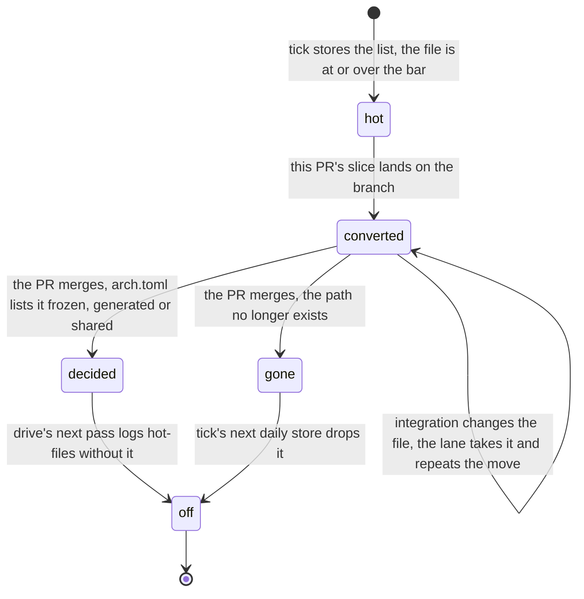
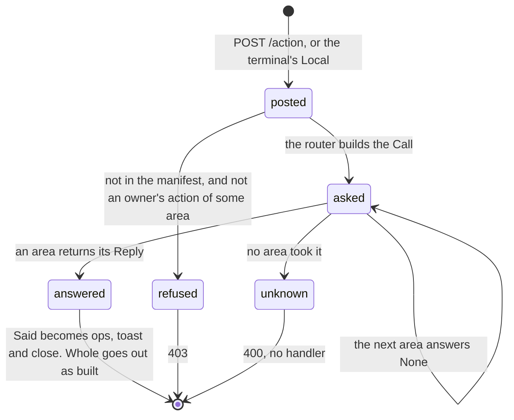

# Boundaries

## Who may call whom

**Screens** (slice 5). Nothing outside the folder changes its calls: the names it uses stay where they are found.

| module | may call | may not |
|---|---|---|
| `serve.rs`, `serve/hub.rs`, `serve/chat.rs`, `serve/tails.rs` | the router's `build_screen`, `screens`, `page_places`; `blocks`' `line`, `ticking`, `iso`, `said`; `ops`; `pages` | an area's builder |
| the router (`mod.rs`) | each area through `AREAS` only; `blocks`; `places`; `later` for the removed cards | name a route or an action; `match` on either (the ban and the 300-line rule) |
| an area (`queue`, `lanes`, `events`, `cards`, `fleets`, `hosts`, `scene`, `threads`) | `Server`'s methods (`queue_tab`, `lanes_tab`, `op`, `act`, `prompt`, `threads_screen`, …), core, `blocks`, its own helper file | another area's builder; it shows another area's screen through the router (`paired_screen`) |
| `issue` (queue's), `later` (cards') | what their area may | be called by another area |
| `blocks`, `ops`, `places`, `pages` | core, `serde_json` | `Server`, an area |
| `local` (the terminal's door) | the router: `perform`, `build_screen`; `places`; `AREAS`' `owner` lists | an area's builder |

`serve/hub.rs` stays the one caller of `build_screen` on the request path (the existing `.build_screen(` ban).

**CI** (slices 1 and 2).

| file | may call | may not |
|---|---|---|
| `ci.yml` | setup actions, the release build, the gates runner, `scripts/test-shards.sh` | hold a gate's command or a path list |
| the gates runner | every gate of the job it is given | know a gate's name or its command |
| a gate | `cargo`, `just`, `scripts/`, the built binary | another gate; it assumes only the workflow's setup steps |
| `scripts/test-shards.sh` | `ls`, `sort`, `cksum` | read a list |

**Config docs** (slice 3). `LIMIT_DOCS` and `Limits::default()` in `crates/core/src/config.rs` are the one source of
a limits key's default and doc line. `config show`, the generated table and the settings screen's help read them;
nothing copies them. The example's fragments are the one source of an optional fleet key's example line;
`fleet.example.toml` is their join and is never edited.

**Docs** (slice 4). A section's file may link any other; an index page links none and lists none.

## A hot file's way off the list

- `hot`: the file is a one-slot serial group (`hot <file>`).
- `decided`: `.github/workflows/ci.yml`, the four docs, `fleet.example.toml`, `web/src/main.ts`.
- `gone`: `scripts/test-shards.txt`, `crates/server/src/screens.rs`. Up to a day longer on the list than the rest.
- The new files start at one merge each, and that merge is a sweep, so at none.

## An action's way through the router

The order of `AREAS` decides nothing: no two areas take the same route, and the one action name two areas take
(`filter`) is told apart in both arms by the screen it came from.
