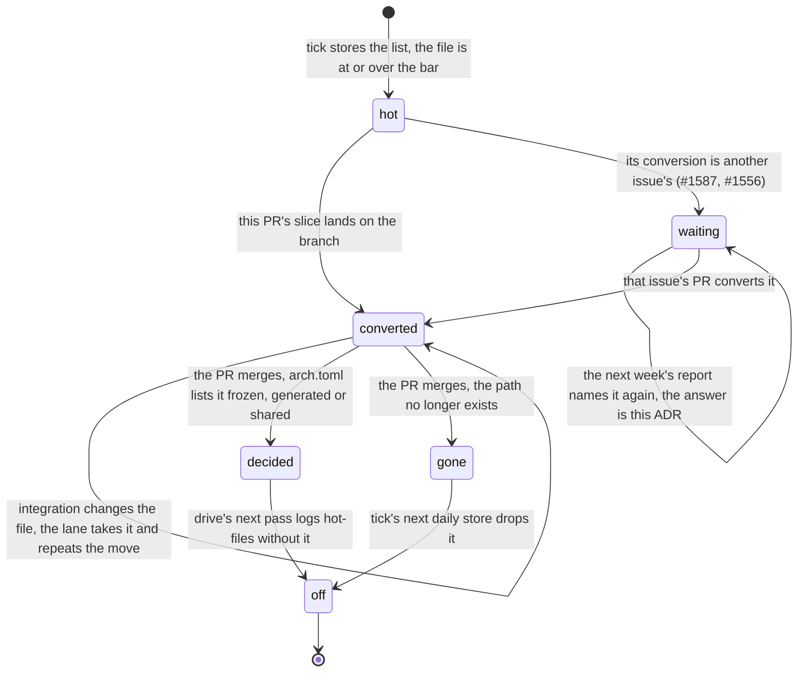
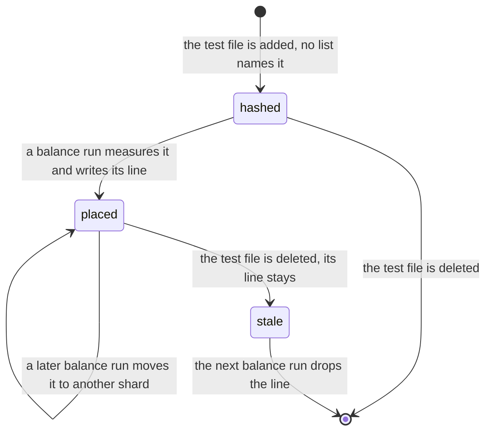

# Boundaries

This PR's. The screens' boundaries and an action's way through the router are in `screens.md` (#1556).

## Who may call whom

**Shards** (slice 1).

| file | may | may not |
|---|---|---|
| `scripts/test-shards.sh <n>` | read the folder's last file; `ls`, `sort`, `cksum`, `awk` | fail on what the file holds or lacks |
| `scripts/test-shards.sh balance` | write the folder's new file and remove the one before it | be the only way a target gets a shard |
| a PR that adds or deletes a test file | nothing | edit the folder |
| `ci.yml`'s `test-shard` job | call the script with its shard number | name a target |

**Config docs** (slice 3). `LIMIT_DOCS` and `Limits::default()` in `crates/core/src/config.rs` are the one source of
a limits key's default and doc line. `config show`, the generated table and the settings screen's help read them;
nothing copies them. The example's fragments are the one source of an optional fleet key's example line;
`fleet.example.toml` is their join and is never edited.

**Docs** (slice 4). A section's file may link any other; an index page links none and lists none.

**The page script** (slice 6). `web/src/main.ts` may grow to 800 lines and no further; a new part of the page is a
new module it imports.

## A hot file's way off the list

- `hot`: the file is a one-slot serial group (`hot <file>`).
- `waiting`: `.github/workflows/ci.yml` (#1587), `crates/server/src/screens.rs` (#1556). Still a serial group.
- `decided` by this PR: the four docs, `fleet.example.toml`, `web/src/main.ts`.
- `gone` by this PR: `scripts/test-shards.txt`. Up to a day longer on the list than the rest.
- The new files start at one merge each, and that merge is a sweep, so at none.

## A test target's shard

In every state but `stale` the target runs in exactly one shard; in `stale` there is nothing to run.
