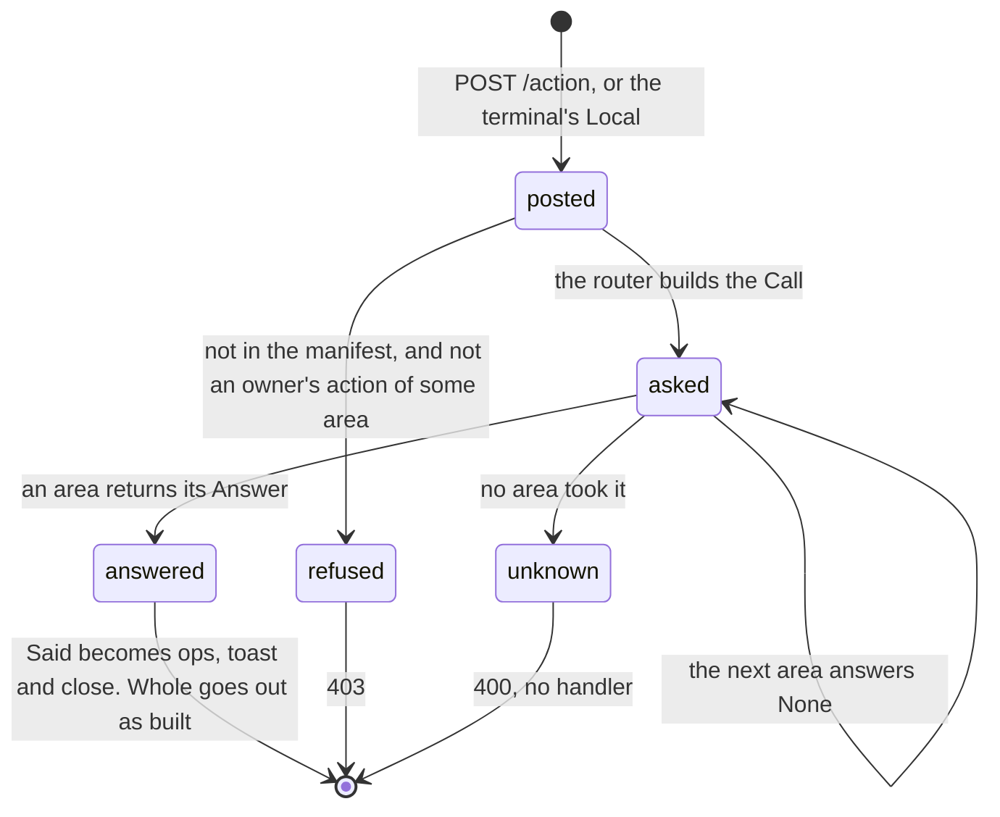

# The screens as one file per area (#1556; the first version's slice 5)

Not in #1548's PR. q2870 moved it to its own issue, #1556, blocked on #1342 (merged 2026-11-22) and on #1548, so
this file is on staging when its lane starts. Redrawn here over #1342's typed builders.

## Where it stands (origin/staging d989c5be)

- `crates/server/src/screens.rs` is 1,985 lines under a 2,000-line limit. It holds most screens' builders and two
  `match` lists in `impl Server`: `build_screen` (19 route arms) and `action` (the handlers of 34 actions; 170 lines,
  over the 150 limit, held by the baseline). 27 of its 52 PRs add or change an arm of one.
- Seven sibling files are mounted with `#[path]`: `screens_lanes.rs`, `screens_fleets.rs`, `screens_hosts.rs`,
  `screens_local.rs`, `screens_pages.rs`, `later.rs`, and `herd_tests.rs` as the tests. `screens_kit.rs` (the typed
  builders, from #1342) is mounted by `serve.rs` as its own `kit`, which `serve/chat.rs` and `serve/hub.rs` use too.
- A route's arm yields a typed block, which `build_screen` then gives the snapshot's age and puts on the wire, or
  returns early with a value already on the wire (fleets, notify, cards, hosts, proxy-token, threads).
- An action's arm yields a toast, which `action` turns into the `Reply` with the removed cards and `close`, or
  returns early with a whole answer (a replaced screen, a dry run's sheet). Host actions never reach `action`:
  `perform` in `screens_local.rs` sends them to `host_op`.

## How the callers read, after

A new screen or action is an arm in its own area's file. The router names no route and no action:

```rust
// crates/server/src/serve/screens/queue.rs
pub(super) const AREA: Area = Area { screen, action, owner: &[] };

fn screen(s: &Server, ctx: &Ctx, r: &Req) -> Option<Built> {
    Some(Built::Block(match r.path {
        "/screens/queue" => s.queue_screen(ctx, r.q),
        "/screens/issue" => issue::sheet(s, ctx, r.q)?,
        "/screens/verdict" => issue::verdict_sheet(&working(&ctx.state).ok()?, r.q)?,
        _ => return None,
    }))
}

fn action(s: &Server, c: &Call) -> Option<Result<Answer>> {
    Some(match c.name {
        "drive" => s.form_op(c.ctx, "drive", &[("fleet", c.fleet())]).map(Answer::said),
        "limit" => c.issue().and_then(|n| crate::limit::wait(c.ctx, &s.r, (&c.fleet(), n), "owner")).map(Answer::said),
        "queue" => tick(s, c),
        _ => return None,
    })
}
```

```rust
// crates/server/src/serve/screens/mod.rs: all that is left of the two lists
let built = AREAS.iter().find_map(|a| (a.screen)(self, ctx, &req))?;
let answer = AREAS.iter().find_map(|a| (a.action)(self, &call)).with_context(|| format!("no handler for `{name}`"))??;
```

## Shapes

```rust
// crates/server/src/serve/screens/mod.rs

/// A screen request: its path, its query, and whether a paired device asks.
pub(super) struct Req<'a> {
    pub path: &'a str,
    pub q: &'a Q,
    pub paired: bool,
}

/// What an area built for a path.
pub(super) enum Built {
    /// A typed block: the router adds the snapshot's age to a full screen, then puts it on the wire.
    Block(k::Block),
    /// Already on the wire, sent as built.
    Wire(Value),
}

/// An action as posted: its name, the block and screen it came from, its form values, and the loaded config.
pub(super) struct Call<'a> {
    pub ctx: &'a Ctx,
    pub cfg: &'a Config,
    pub name: &'a str,
    pub block: &'a str,
    pub from: &'a Value,
    pub values: &'a Value,
}

impl Call<'_> {
    pub fn s(&self, key: &str) -> String;      // a value as text; "" when absent
    pub fn fleet(&self) -> String;
    pub fn issue(&self) -> Result<u64>;        // "no issue" when absent
}

/// What an action answers.
pub(super) enum Answer {
    /// A toast line; `close` closes the sheet the action came from. The router adds the cards it removed
    /// and sends today's `Reply`.
    Said { toast: String, close: bool },
    /// The whole answer as built: a replaced screen, a dry run's sheet, a host action's.
    Whole(Value),
}

impl Answer {
    pub fn said(toast: String) -> Answer;      // `Said` that leaves the sheet open
}

/// One area of the screens: its routes and its actions, in its own file.
pub(super) struct Area {
    /// Its screen at the request's path; `None` when the path is not its own, or the screen has no data.
    pub screen: fn(&Server, &Ctx, &Req) -> Option<Built>,
    /// Its answer to the action; `None` when the name is not its own.
    pub action: fn(&Server, &Call) -> Option<Result<Answer>>,
    /// Its actions the owner may run though `cooee-plugin.toml` lists none of them.
    pub owner: &'static [&'static str],
}

const AREAS: &[Area] = &[
    queue::AREA, lanes::AREA, events::AREA, cards::AREA, fleets::AREA, hosts::AREA, scene::AREA, threads::AREA,
];
```

Where today's items go (`crates/server/src/serve/screens/*.rs`). A helper may land elsewhere when the lane reads the
code; the boundaries below are the rule.

| file | from | routes | actions |
|---|---|---|---|
| `mod.rs` (the router) | `build_screen`'s frame and the age row, `screens`, `action`'s frame, `Reply`, `plugin`, `form_op`, `paired_screen` | none | none |
| `queue.rs` | `queue_screen`, `on_row`, `fleet_card`, `row`, `done_screen`, `backlog`, `stats`, `counts`, the hot sheet, `workflow` | queue, queue/done, backlog, hot, issue, verdict, workflow | filter, drive, drive-all, force, pause, top, drop, move, queue, limit, unpark |
| `issue.rs` (queue's) | `issue_sheet`, `check_rows`, `history`, `rounds`, `verdict_sheet` | | |
| `lanes.rs` | the lane half of `screens_lanes.rs`, `lane_sheet`, `dry_run` | lanes, lanes/<agent> | stop, kill, clean, close, send |
| `scene.rs` | the scene half of `screens_lanes.rs`; `herd_tests.rs` as its tests | scene | none |
| `events.rs` | `events_screen`, `groups`, `when`, `kind_of` | events | filter (from the events screen) |
| `cards.rs` | the ask, needs-human, run and health cards, `ask_sheet`, `health_sheet` | cards, ask, drive-health | answer, needs-human, run-card, config-card |
| `later.rs` (cards') | today's `later.rs`: `chat_cards`, the removed cards, the undelivered sends | | |
| `fleets.rs` | today's `screens_fleets.rs` | fleets, notify | save-fleets, remove-fleet |
| `hosts.rs` | today's `screens_hosts.rs` | hosts, proxy-token | `HOST_ACTIONS`, through `host_op` |
| `threads.rs` | `THREAD_ACTIONS` and their arm | threads, threads/<id> (built by `serve/chat.rs`) | the thread actions, thread-signin, secret-card |
| `parts.rs` | the helpers every area uses: `out`, `line`, `Res`, `ticking`, `since`, `iso`, `state`, `figure`, `cut`, `section`, `rows_list`, `tile` | | |
| `places.rs` | `permitted`, `places`, `page_places`, `screen_files` | | |
| `local.rs`, `pages.rs` | today's `screens_local.rs`, `screens_pages.rs` | | |
| `kit.rs`, beside the folder in `crates/server/src/serve/` | today's `screens_kit.rs`; still serve's `kit`, so no caller changes | | |

- `local.rs`'s permission check reads `AREAS`' `owner` lists where it reads `THREAD_ACTIONS` and `HOST_ACTIONS`
  today, and `perform` sends every action through `AREAS`: its own host arm goes.
- The `filter` action is two arms: events' matches when the call came from the events screen, queue's otherwise.
- Each arm says its own `close`; the router's list of closing names goes.
- A pure move: every screen's JSON and every action's reply stay byte for byte, held by the existing tests.

## Who may call whom

Nothing outside the folder changes its calls: the router re-exports the names `serve.rs`, `serve/hub.rs` and
`serve/chat.rs` use today (`line`, `Res`, `ticking`, `iso`, `state`, `pages`, `page_places`, `local`).

| module | may call | may not |
|---|---|---|
| `serve.rs`, `serve/hub.rs`, `serve/chat.rs`, `serve/tails.rs` | the router's `build_screen`, `screens` and re-exports; serve's `kit` | an area's builder |
| the router (`mod.rs`) | each area through `AREAS` only; `kit`; `parts`; `later` for the removed cards | name a route or an action; `match` on either (the ban and the 300-line rule) |
| an area (`queue`, `lanes`, `events`, `cards`, `fleets`, `hosts`, `scene`, `threads`) | `Server`'s methods (`queue_tab`, `lanes_tab`, `op`, `act`, `prompt`, `threads_screen`, …), core, `kit`, `parts`, `pages`, its own helper file | another area's builder; it shows another area's screen through the router (`paired_screen`) |
| `issue` (queue's), `later` (cards') | what their area may | be called by another area; one exception, as today: `lanes` reads `later`'s undelivered sends |
| `kit`, `parts`, `places`, `pages` | core, the blocks crate, `serde_json` | `Server`'s state, an area |
| `local` (the terminal's door) | the router: `perform`, `build_screen`; `places`; `AREAS`' `owner` lists | an area's builder |

`serve/hub.rs` stays the one caller of `build_screen` on the request path (the existing `.build_screen(` ban).

## An action's way through the router



The order of `AREAS` decides nothing: no two areas take the same route, and the one action name two areas take
(`filter`) is told apart in both arms by the screen it came from.

## Consequences

- `crates/server/src/screens.rs` no longer exists and leaves the list at the next daily store after #1556 merges.
- A new screen or action edits one area's file. The busiest area (the queue's) had 16 of the 52 PRs.
- The move adds import lines and eight area tables: `src/` net about +150. The baseline loses `screens.rs:action 170`.
- A fleet's serial group that names the old screens path matches nothing afterwards; the new folder is under
  `crates/server/src/serve/**`, which that group already lists.
- The `json!` ban covers every file of the folder but the four that hold one today, so a new area file is under it
  from its first line.
- #1562 splits `crates/server/src/serve.rs` beside this folder. The two do not share a file; whichever merges
  second takes an update round for its `mod` lines.
- When integration changes a screens file under the PR, the lane takes integration's file and repeats the move.

## The `.drover/arch.toml` lines (#1556's PR)

Added. Two rules keep the router from growing back into a list:

```toml
[[size]]
paths = ["crates/server/src/serve/screens/mod.rs"]
max_file_lines = 300

[[ban]]
pattern = '"/screens/'
paths = ["crates/server/src/serve/screens/mod.rs"]
reason = "#1556: a route is matched in its area's file (crates/server/src/serve/screens/<area>.rs), never in the router"
```

Edited in place (the `skip` entry keeps this folder's mentions of the deleted path from failing the docs check):

```toml
[docs]
skip = [".drover/**", "roles/usage-tail.md", "scripts/test-shards.txt", "crates/server/src/screens.rs"]

[[ban]]
pattern = "json!"
paths = ["crates/server/src/serve/screens/**", "crates/server/src/serve/kit.rs", "crates/server/src/serve/chat.rs"]
except = [
    "crates/server/src/serve/screens/fleets.rs",
    "crates/server/src/serve/screens/hosts.rs",
    "crates/server/src/serve/screens/later.rs",
    "crates/server/src/serve/screens/local.rs",
]

[[ban]]
pattern = ".build_screen("
except = ["crates/server/src/serve/hub.rs", "crates/server/src/serve/screens/mod.rs", "crates/server/src/serve/screens/local.rs"]
```

The path is deleted: no `frozen` line.
