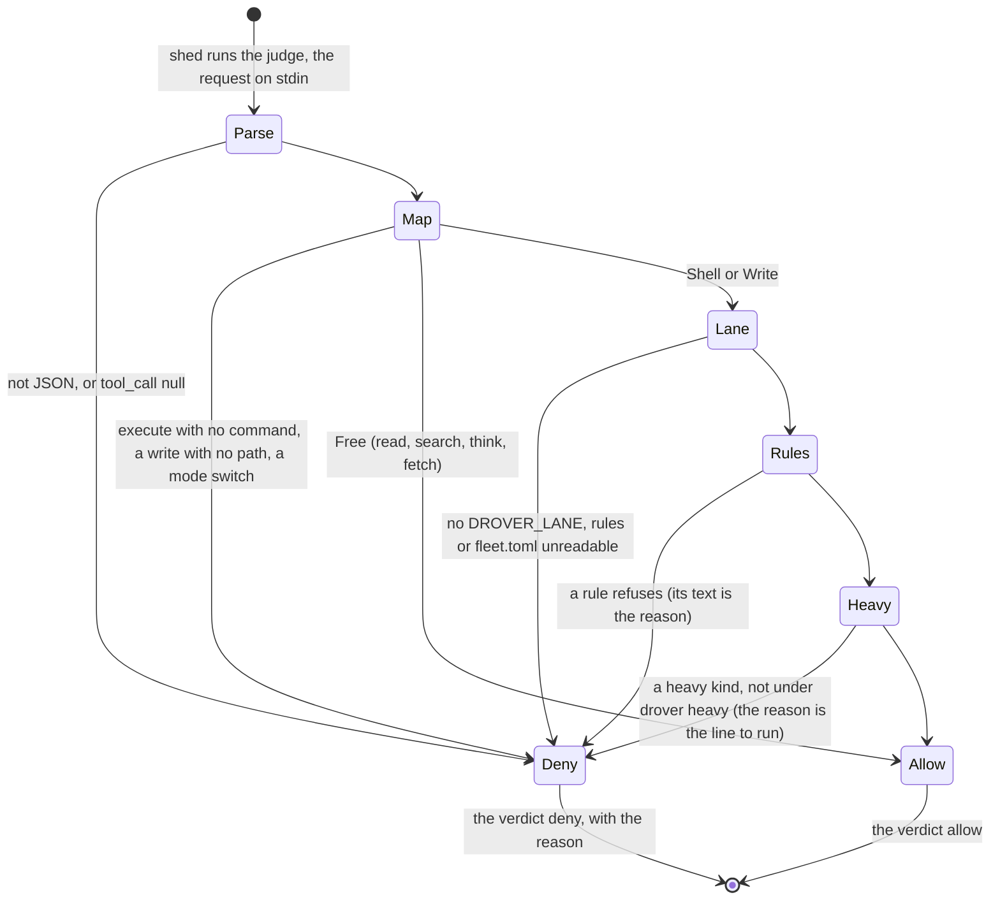
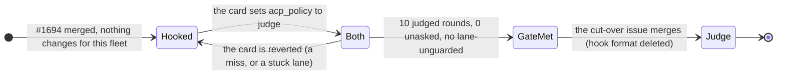

# judged-lanes: module boundaries and the statecharts (#1694)

## Who may call whom

```
shed (wire, cli) <── agents (shed's list)  <── spawn, doctor, setup, hosts, config checks, server (cached)
       ^         <── term (run words)      <── spawn, orchestrator, judge::probe
       ^         <── session (events)      ──> judge::audit ──> hook (rules)
cli hook, ACP mode ──> judge (wire, call) ──> hook (rules)
providers (one module's extras) <── spawn, proxy, profiles sync
```

| Module | Owns | May call | Must not |
|---|---|---|---|
| `core::agents` (new, `agents.rs`) | `Agent`, `Catalog`; the one reader of `shed agents --json`; `fits`, `effort`, `signed_in`, `named`, the doctor row | `shed::cli`, `hosts::On`, `config` | name an agent id; know a lane or a rule |
| `core::judge` (new, `judge/mod.rs`) | `Request`, `ToolCall`, `Verdict`, `Guard`; `guard`, `ready`, `command`, `answer` | `judge::call`, `hook`, `agents` (types), `providers::of` (has it a hook format) | start a process but through the runner; read a hook-format JSON |
| `judge::call` (new) | ACP `toolCall` to `hook::Call`: the mapping table, nothing else | `hook::Call` | read config, env or the log |
| `judge::probe` (new) | the test run, `Verdict`, the `agent-guard` stamp | `term`, `shed`, `events`, `agents` | run on serve's request path |
| `judge::audit` (new) | asked and unasked calls per lane; `judge-unasked`, `lane-unguarded` | `judge::call`, `hook::decide`, `hook::policy`, `events`, `session::pulse` | call `term`; the follower stops the lane |
| `hook` (`hook.rs`) | `Call`, `Policy`, `Rules`, `decide`, `policy`; every rule | config, events, hygiene, heavy, card | name ACP or a hook format (after the cut-over); know who sent the call |
| `core::session` | shed's events for a lane: state, pulse, and now turn end, push and the audit's feed | `shed`, `events`, `judge::audit`, `drive::kick_once`, `term` (the turn line, stopping a lane) | judge a call itself |
| `term` (`term.rs`) | the `shed run` words, with the judge's when judged | `shed` | choose the guard |
| `providers` | one module: token proxy, profile files, session options, sandbox needs, brands; until the cut-over its hook format | as today | be asked for install, login, status, model, effort, vendor or an agent's name: those methods leave the trait |
| `spawn`, `orchestrator` | the plan and the start | `agents`, `judge` (`guard`, `ready`, `probe::guarded`, `command`), `term`, `providers::of` | read shed's list themselves; build judge words |
| server | chips and rows | `agents::Catalog::cached` only | call shed on a request |

The `Provider` trait after slice 5: `proxy`, `sync`, `ready`, `prepare`, `acp_profile`, `acp_meta`,
`chat_settings`, `sandbox`, `profile_files`, `hooks_allowed`, `doctor`, `scrubs_env`, `env`, and until
the cut-over `hook_dialect`. `providers::of(agent_id)` returns the module for that id, else the empty
default. `Surface`, `lanes`, `acp_only`, `lane_names`, `known`, `default_acp`, `of_agent`,
`vendor_of_agent` and the methods `vendor`, `login`, `install`, `health_check`, `efforts`, `takes_model`,
`model_default`, `acp`, `acp_env`, `token_env`, `sessions`, `process_names` are deleted.

## One judged call



shed adds its own deny when the judge exits non-zero, prints no verdict or takes over `judge_secs`.

## An agent's guard on one host

```mermaid
stateDiagram-v2
    [*] --> Unknown: a role names it; no stamp for its installed version
    Unknown --> Guarded: it asked before the shell command, drover read the call, no marker file
    Unknown --> Unguarded: a marker file exists
    Unknown --> Unreadable: it asked, the command or path could not be read
    Unknown --> Inconclusive: signed out, silent, or it never tried
    Guarded --> Unknown: shed lists a new version
    Guarded --> Unguarded: lane-unguarded (an unasked call the rules refuse)
    Unguarded --> Unknown: a new version, or doctor runs the test again
    Unreadable --> Unknown: a new version or drover build, or doctor
    Inconclusive --> Unknown: doctor, or the next spawn after the host is signed in
```



Spawn starts a judged lane only in `Guarded`. In `Unknown` it runs the test once, inline, within
`probe_seconds`. In the other three it refuses `ACP_UNGUARDED` at once, with the agent, the host and
the stamp's reason, and spends no turn.

## The cut-over, per fleet


