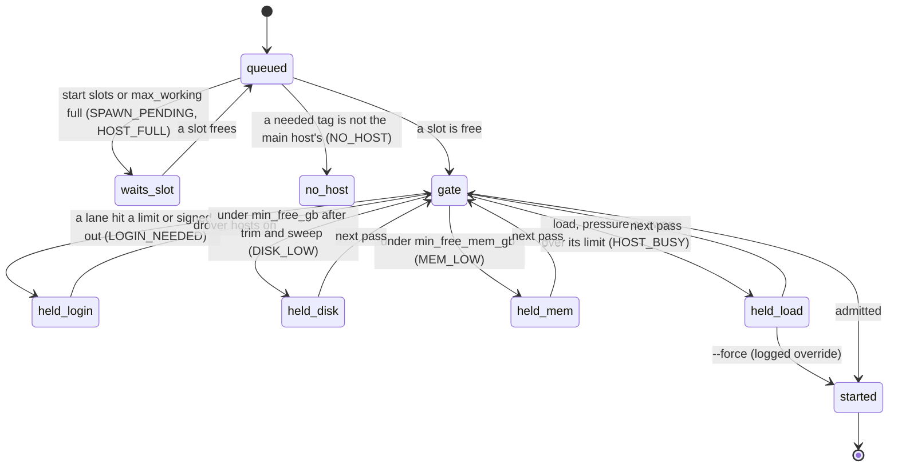
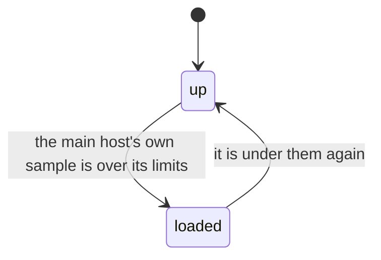
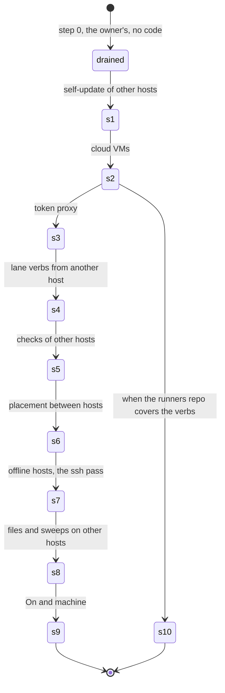

# main-host-only: module boundaries and statecharts (#1691)

## Who may call whom, after the cut

```
 cli ──▶ spawn ──▶ hosts::place ──▶ hosts::gate ──▶ host::sample        (this host's load, memory, swap)
            │            │               └────────▶ hosts::disk_low ──▶ check::trim_builds, check::sweep
            │            └──▶ roots::pick
            └──▶ term, shed                                             (this host's shed socket)

 drive ──▶ starts, hosts::slot_before, hosts::working_full              (start, working, simulator slots)
 check ──▶ hosts::survey ──▶ host::sample, hosts::probe                 (one host: its tags, its numbers)
 hook ───▶ heavy                top ──▶ host, heavy
 update ─▶ release                                                      (this host's binary)

 service ──▶ link::run ──▶ `drover hosts watch` (a child on this host) ──▶ link::intake ──▶ state.db view
 drive, check, waiting, lanes, serve ──▶ link::view::View               (lane facts; never a call to shed)
```

| Module | Owns after the cut | May call | Must not |
|---|---|---|---|
| `hosts` | admission, the slot counts, the login hold, placement on the main host, the tag probe, the Host tab's history | `host`, `roots`, `session`, `events`, `config`, `check` (trim and sweep, for `DISK_LOW`) | name `ssh`; take a machine; choose between hosts |
| `host` | this host's sample: load, memory, swap, processes, free disk | `runner`, `sys` | read the log or the config's `[hosts]` |
| `roots` | workspace roots, eject, a pulled root | `runner`, `events`, `spawn` (the restart) | reach another host's disk |
| `link` | this host's frames, intake, the view | `shed` (its sessions), `runner` (git in a worktree), `db` | wrap a command in ssh; carry a lane's verb |
| `spawn` | the plan, the worktree, the start | `hosts::place`, `roots`, `term`, `shed`, `secret`, `hook::Rules` | rewrite a path for another home; write a rules file or a lane key |
| `update`, `release` | the main host's own binary: find, stage, check, swap | `runner`, `gh`, `timer`, the serve's control socket | stage or swap anywhere else |
| `heavy` | heavy slots on this host; which command is heavy | `config`, `sys` | know a build machine: the later policy rewrites a command to `runners run` in the hook, beside `Heavy::wrap` |
| `cli` | every verb runs here | all of core | queue a lane's verb in a file |
| `config` | fleet.toml; the one main-host entry; the old-key warnings | serde, toml | fail a load on a key this cut removed |
| `events` | the fold; `Event::here` | nothing new | drop an old event of another host from the fold |
| `crates/server` | the Host tab: one card | `hosts::cards`, `hosts::history`, the view | show a toggle, a proxy section or a cloud row |

Three rules, each with its check (`adr.md`, the `.drover/arch.toml` lines):

1. **No module reaches another host.** `ssh` is named only where it is data: the hook's wrapper words, the
   sandbox's deny list and the hygiene check's patterns. A ban holds it after slice 9.
2. **`hosts::On` is gone.** A lane's files are this host's files and its commands run on the runner. The
   existing ban on `hosts::On` widens to all of `crates/*/src` in slice 9.
3. **Only `Event::here` reads a `machine` off the log.** New events carry none.

No layer edge changes: `core` still depends on neither `server` nor `cli`, and every process still starts in
`runner.rs`.

## A start on the main host (what stays)



Every state and edge here is today's. The cut removes the states beside them: another host picked, a cloud host
woken, `HOST_OFFLINE`, `HOST_UPDATING`, `unhealthy`, the move to another host.

## The host fact



`draining` and `offline` leave the flow table in slice 7. A main host that is down runs no drive pass, so no
row could ever see it offline.

## The cut itself



`drained` holds when the five lines of step 0 hold (`adr.md`). From there no remote code path can run: every
slice removes code that is already dead on the live host, so none needs a gate of its own and no lane restarts
at any merge. Slices 1 to 9 are serial: each edits `hosts.rs`, `check.rs`, `spawn.rs`, `cli.rs` or `config.rs`,
which every other one edits too. Slice 10 waits only for slice 2 and for the runners repo.
