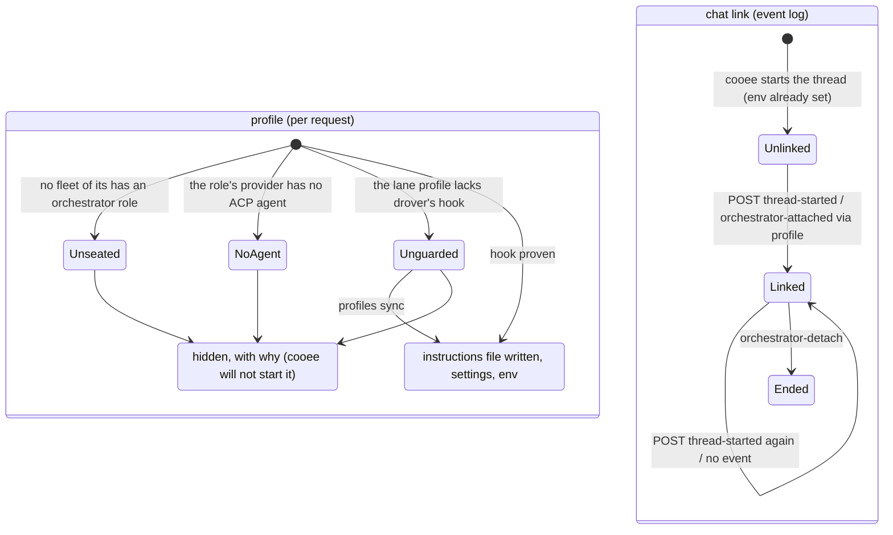

# Orchestrator chat profile: module boundaries and state (#1057)

## Where the code goes

```
crates/server/src/cooee.rs              new   the /cooee/* routes: token, parse, answer. No text, no config fields.
crates/server/src/serve.rs              +3    `#[path = "cooee.rs"] mod cooee;` and one router arm for `/cooee/`
crates/server/src/screens.rs            ±1    `fn plugin` becomes `pub(super)` (the token check, shared)
crates/core/src/orchestrator/chat.rs    new   Seat, ChatProfile, profiles(), started()
crates/core/src/orchestrator/brief.rs   new   thread(), chat(), standing(): moved out of orchestrator.rs
crates/core/src/orchestrator.rs         −40   `mod brief; pub mod chat;`, `link()` shared by attach, `route()` skips chat links
crates/core/src/providers/mod.rs        +3    `Provider::chat_settings`, default the folder's `settings.json`
crates/core/src/providers/<one>.rs      +3    the provider whose ACP adapter takes a config folder returns the folder
crates/core/src/spawn.rs                ±2    `role_prompt("orchestrator")` joins the role and thread parts
crates/core/src/config.rs               +5    the `[orchestrator.<id>]` id check
roles/orchestrator/{role,thread,chat}.md  new   roles/orchestrator.md split and deleted
crates/cli/tests/cooee_profiles.rs      new   the AC tests, a golden key list for cooee's `Profile`
docs/cooee-profiles.md                  new   the routes, the profile's keys, the persona line, the live check
```

Rough size: src net about +150.

## Who may call whom

```
 cooee ──HTTP──▶ serve.rs router ──▶ cooee.rs ──▶ orchestrator::chat ──▶ orchestrator::brief ──▶ role parts, usage_doc
                                                        │                        ▲
                                                        │                        └── orchestrator.rs start(), attach()
                                                        ├──▶ orchestrator::{role, defaults, name, link}
                                                        ├──▶ spawn::unguarded, providers::{get, profiles_root}
                                                        └──▶ events::emit  (only in started(), through link())
```

| Rule | Enforcer |
|---|---|
| `cooee.rs` calls core only through `orchestrator::chat::{profiles, started}`; it builds no text and reads no config field | review; the file is the sketch in the README |
| Only `brief.rs` reads the owner's instructions, memory and skills, and only `standing()` does it | `brief` is private to `orchestrator`; `chat` and `start` get strings |
| No provider is named outside the providers folder: the settings path comes from `Provider::chat_settings` | arch-check `[[ban]]` |
| `ChatProfile` is built only by `offered` and `hidden` | private fields: the compiler |
| The served keys are ones cooee's `Profile` has | the test's golden key list |
| The chat brief names no drover-thread verb | a test: the served text has none of `thread reply`, `thread handoff`, `--typed`, `card post`, `config propose`, `secret request` |
| A hook edit to `<state dir>/chat/` is refused | the hook's protected paths (already there) |

## State

Nothing new is stored but the link event. A profile's offer is derived on every request; a chat's link is in the log.



| State | `drover hook` refusals | `ask --thread`, `answer --basis`, `extend --basis` | Lane asks routed to it |
|---|---|---|---|
| Unlinked (the seconds before the POST) | yes, from the env alone | `NO_SUCH_THREAD` | no |
| Linked | yes | yes (`--basis` only for asks on the lane fleet) | no (`via: profile` links are skipped by `route()`) |
| Ended | yes | `NO_SUCH_THREAD` | no |
