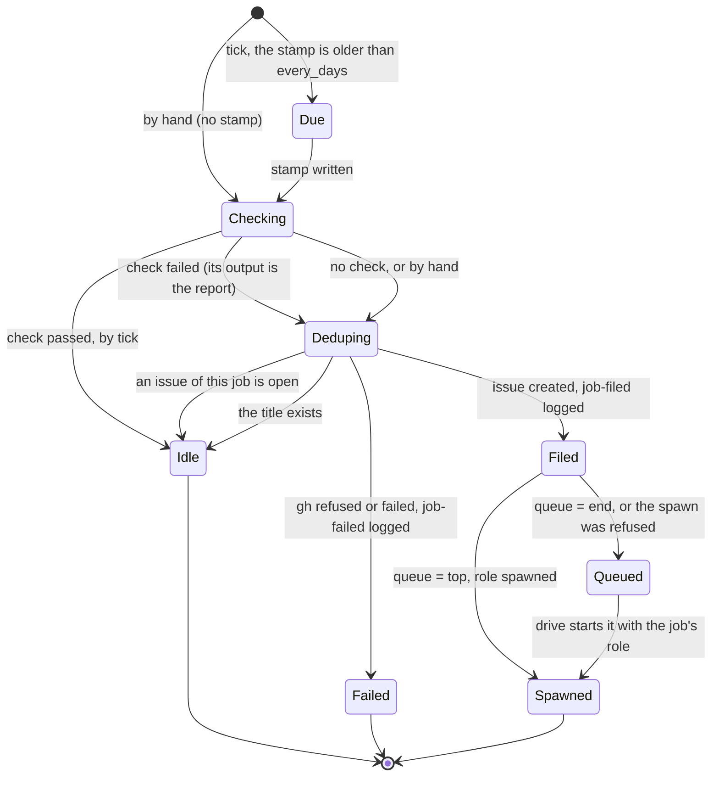
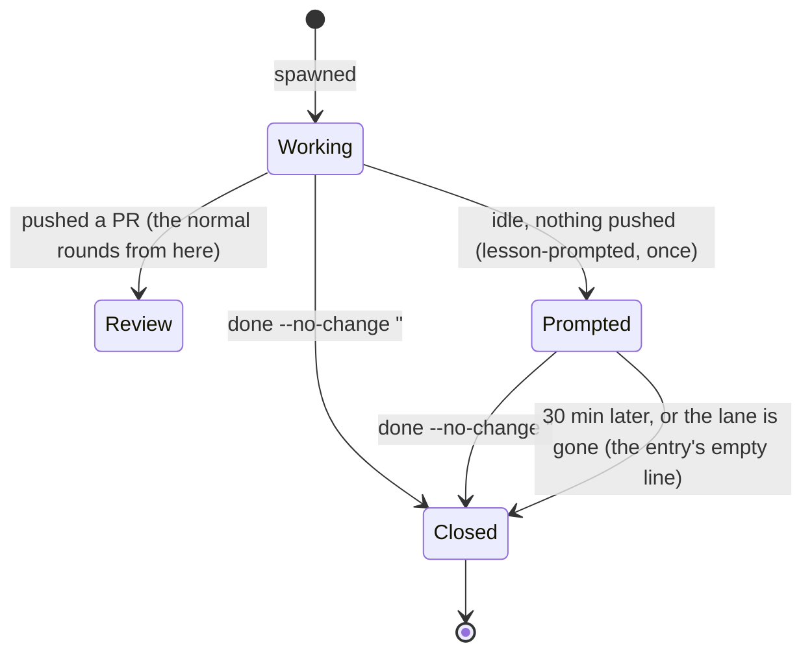

# Boundaries and statecharts

## Who may call whom

| Module | May call | Never |
|---|---|---|
| `jobs` (new, `jobs.rs` in core) | `config`, `events`, `timer::due`, `queue`, `spawn::spawn`, `gh` (create an issue, find a title), `clone` (the checkout), `runner` | `lesson`, `triage`, `hotspots`: it names no job and no role |
| `timer::tick` | `jobs::tick`, one step named `jobs` | a job's module |
| `cli` | `jobs::cli` for the `job` verb; `jobs::close` from `done --no-change`; the lane verbs in `lesson`, `triage`, `hotspots` | |
| `drive`, `waiting` | `jobs::role`, `jobs::empty`, `jobs::close`; `hotspots::sync` | `lesson::…` for a lane's end |
| `server` v1 | `jobs::run` (`POST lesson`), `jobs::last` (`GET lessons`), `lesson::digest` | |
| `lesson` | `jobs::of`, to know a lessons issue for the prose-only rule | `jobs::run` |
| `triage`, `hotspots` | nothing in `jobs` | |
| `soak` | `gh`'s title search, moved there from `deps` | |

`deps.rs` is deleted. Its title search moves to `gh.rs`; `jobs` and `soak` use it.

Role policy stays where it is, keyed on the role: the role prompt and the triage brief in `spawn`, the read-only
triage lane and `TRIAGE_VERBS` in `hook`. A job entry carries no policy.

Enforced by three `[[ban]]` lines on `jobs.rs` ([adr.md](adr.md), last section).

## A job run

- The stamp is written before the check, as today. A failed or skipped run waits one period; the `job` verb runs
  it sooner.
- A refused spawn (`HOST_BUSY`, `IN_FLIGHT_CAP`, `PAUSED`) is not a failure. The issue is queued, and drive starts it
  with the right role because `job-filed` names it. Today drive starts it as `impl` and the code sniffs the title.
- The check runs through the tick's pass runner, under the tick's budget, as today's advisory scan does.

## A job's lane that may end without a PR (`empty` set)

`Closed` is one step, `jobs::close`: `gh issue close` with the line and the lane's undo list as its comment, then the
`closed` event. A job without `empty` has no such path: its idle lane is nudged and blocked like any impl lane.
