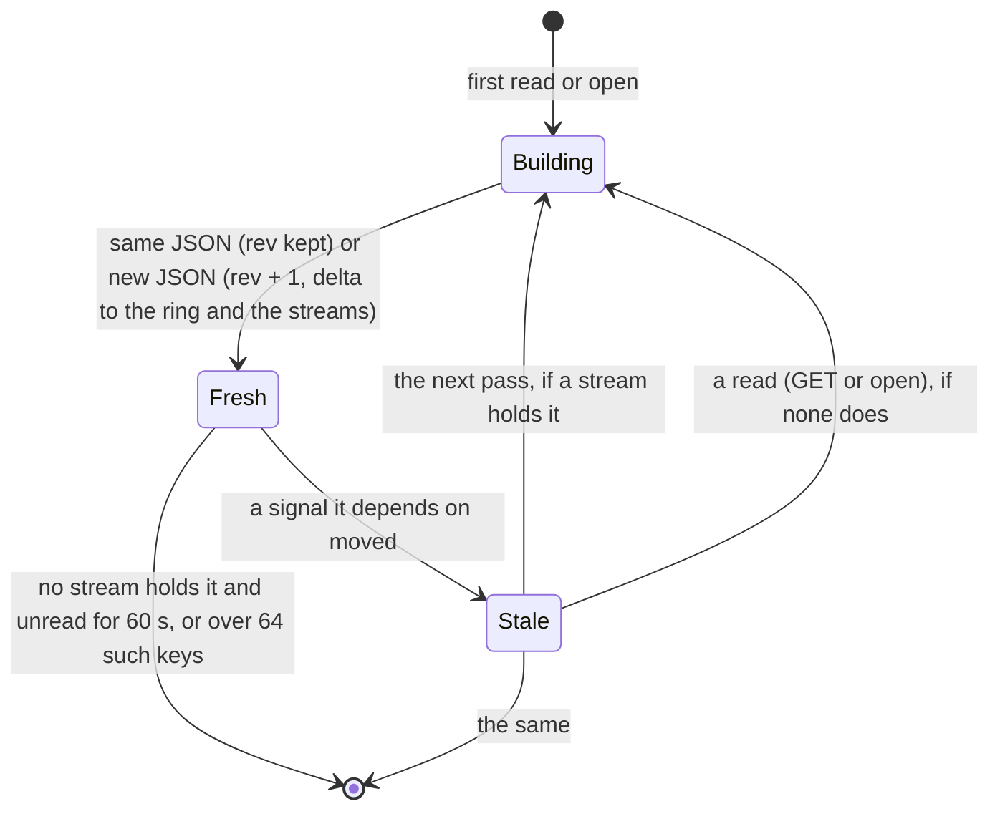
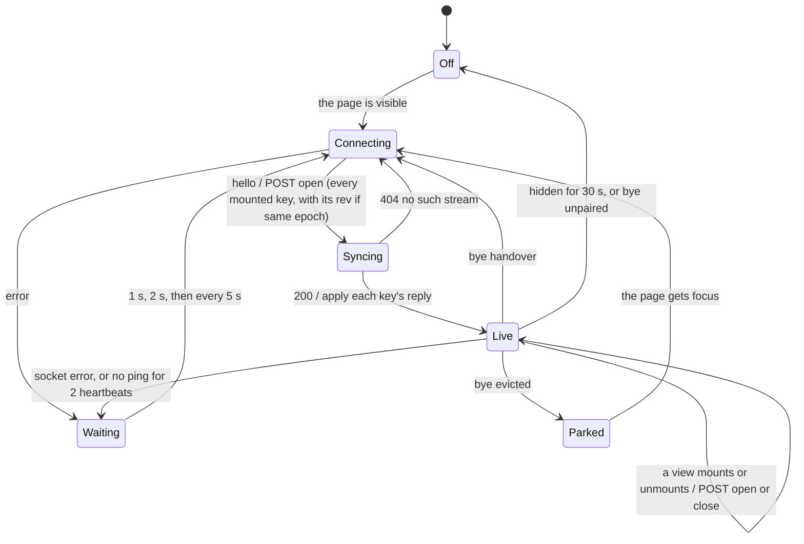
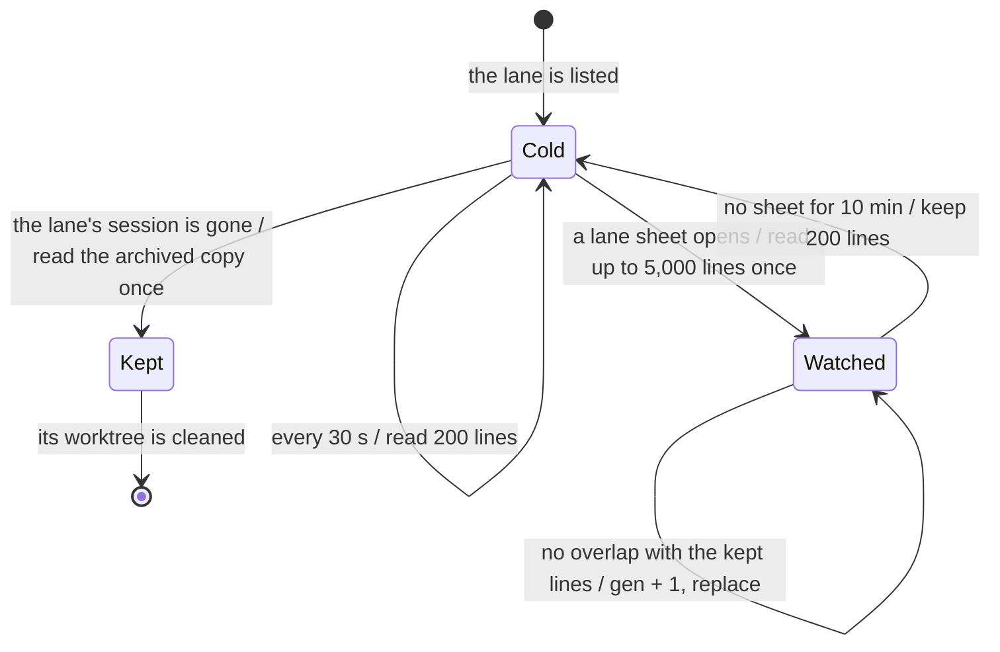

# screen-hub: module boundaries and the statecharts (#1318)

## Who may call whom

```
socket ──> serve.rs (routes) ──> stream ──> hub ──> screens (builders) ──> tails ──> core::session::transcript
                 │                           │  └──> delta (diff)            └────> core (events, config, gh cache)
                 └── GET /screens/<x> ───────┘
page:  main.ts ──> stream.ts ──> patch.ts ──> blocks.ts (render one block)
```

| Module | Owns | May call | Must not |
|---|---|---|---|
| `serve/hub.rs` (new) | `Hub`, `Key`, `Built`, `Signals`, the ring, single flight, the publisher's pass, per-key build times for `/api/v1/health` | `screens::build_screen`, `screens::deps`, `delta::ops`, `db::last_seq`, `db::stamp`, `Fresh` (its counter), `Tails` (a lane's generation), `conductor::mark_read` after building a thread key a paired stream holds | write to a socket; know a device or a stream's queue; build outside `runner::request` (a build never starts a process) |
| `serve/delta.rs` (moved out of `screens.rs`) | `ops`: two screens in, `Vec<Op>` out; the list root; `log` containers | `serde_json` | read state, time or config |
| `serve/stream.rs` (new) | sessions, the per-device limit, `hello`/frame/`bye` framing, the `POST` sync, cooee's one-key stream | `Hub::open`, `Hub::close`, `Hub::read`; `devices::check`; `Tails::watch` when a lane sheet key opens | build or diff a screen; keep anything after its socket closes |
| `serve/tails.rs` (new) | `Tails`, the feeder thread, line numbers, `page` | `session::transcript` through `hosts::On` and the runner (off the request path), `lanes::mask` | be read from shed on a request; render blocks |
| `screens.rs` | the builders, `deps`, the actions | `Tails::tail`, the rest as today | hold a stream, a counter of streams or a diff (`stream`, `STREAMS`, `ops` leave); mark a thread read inside a build (the GET route and the hub do) |
| `serve.rs` | routes, the threads `serve_with` starts | `Hub::read`, `Hub::kick`, `stream` | call `build_screen` (the static export, in `screens.rs`, is the one caller besides the hub) |
| `api.rs` | `Op`, `Frame`, `Hello`, `Sync`, `Synced` | | |
| `stream.ts` (new, in `web/src`) | the one `EventSource`, `hello`, the sync `POST`, revs, gaps, backoff | `fetch` | touch the DOM |
| `patch.ts` (new, in `web/src`) | ops onto a view: its model by id and its nodes by `data-id`; the debounced save | `blocks.ts` `render` for one block | clone a model; call `paint` |
| `main.ts` | views, tabs, sheets: `mount`, `unmount` | `stream.ts`, `patch.ts` | open an `EventSource`; fetch a screen while the stream is live |

Threads `serve_with` runs after the change: the publisher (one), the tail feeder (one), one writer per open stream.
The per-stream build loop and its 500 ms poll go.

## A cache entry (the hub)



A second reader of a key that is `Building` waits for that build. Signals that move during a build leave the entry
`Stale`, and the next pass builds once more: at most one build of a key at a time, and the newest signals win.

## The device stream, on the page



The sync dot: green in `Live`, amber in `Connecting`, `Syncing` and `Waiting`, red when offline or `Parked`. A tab
the owner has opened stays mounted while the page is visible, so its badge is live and switching to it needs no read.

## A stream, on the server

```mermaid
stateDiagram-v2
    [*] --> Attached: GET /stream (allowed host; device or peer known)
    Attached --> Attached: POST / subscribe, unsubscribe, reply with each key's state
    Attached --> Attached: the hub publishes a key it holds / queue a frame
    Attached --> Lagging: queue over 64 frames or 1 MB / drop the queue
    Lagging --> Attached: the writer catches up / each held key's next frame is a whole screen
    Attached --> [*]: socket error, 2 heartbeats unsent, evicted, device unpaired, handover
    Lagging --> [*]: the same
```



Closing a stream drops its subscriptions. Nothing is kept for it.

## A lane's tail



Remote lanes are read in one call per host per round, as the snapshot does.
