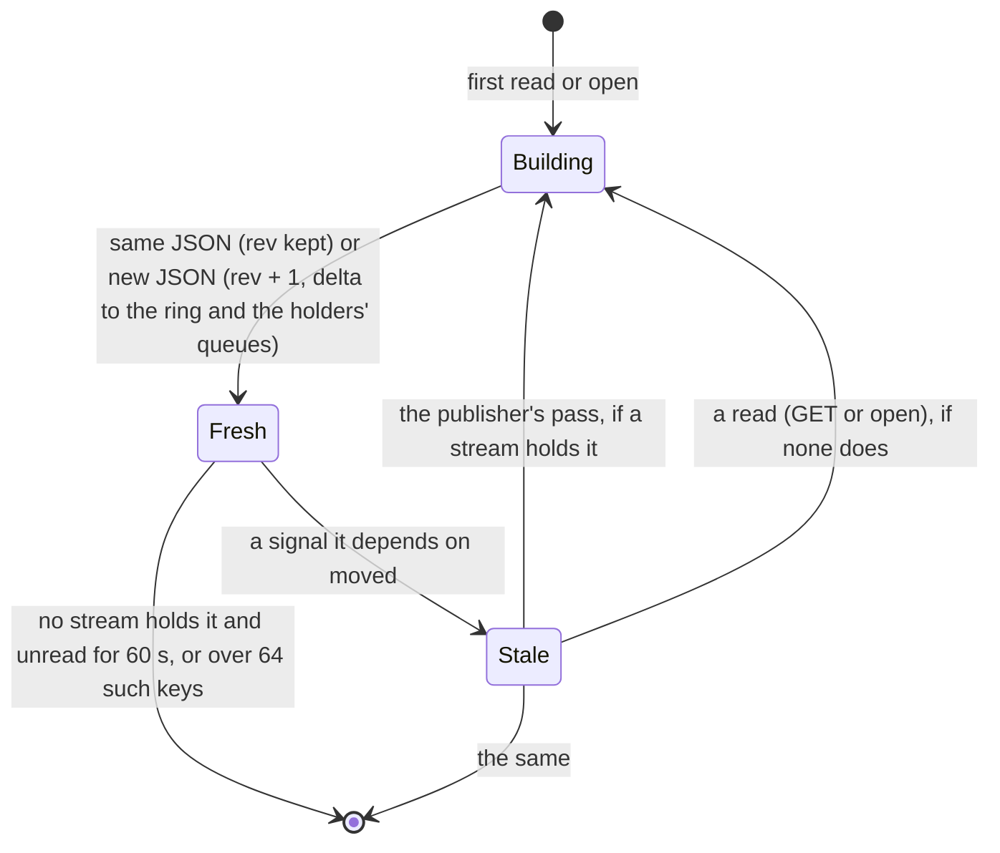
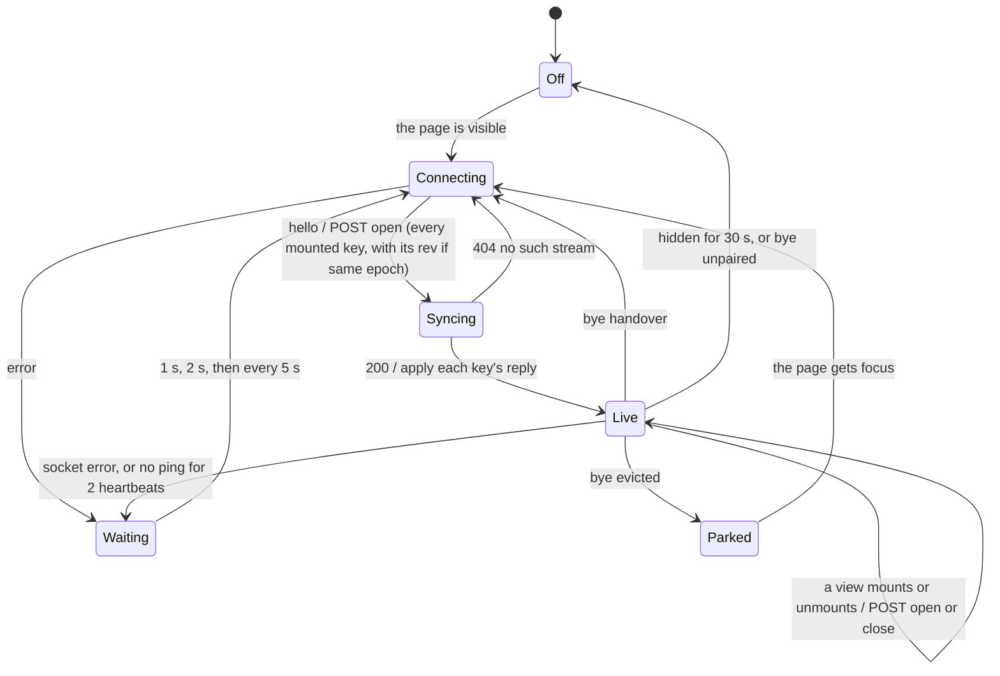
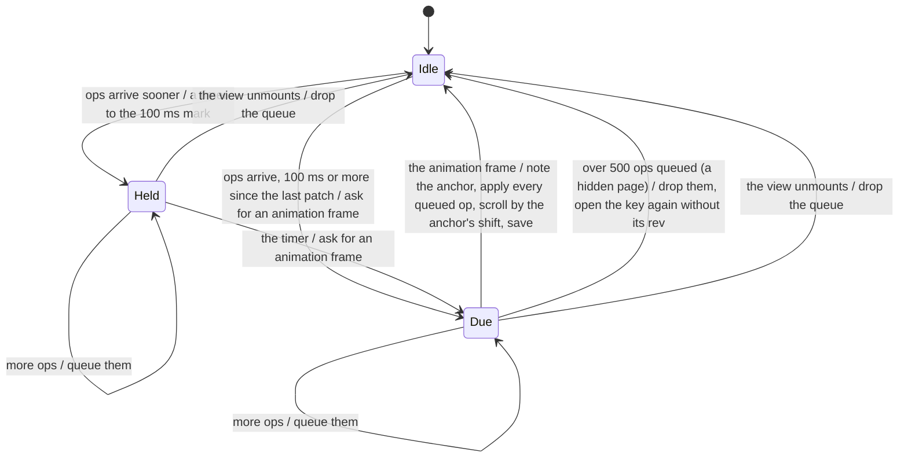
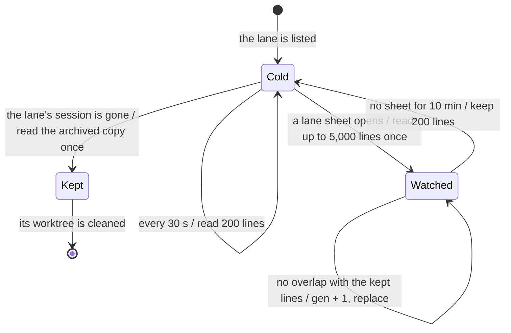

# screen-hub: module boundaries and the statecharts (#1318)

## The repos and the crates

```
<org>/blocks                 its own repo, built by its own issues (q2071); it names nothing of drover's
  its crate       the diff, the ops, the frames, both ends' bookkeeping    no tokio, no clock, no socket
  its TS package  the generated types, the stream client, the patcher
        ▲ one commit: a git rev in Cargo.toml (slice 4), the same in web/package.json (slice 6)
drover-server ──> drover-core ──> drover-sys          tokio: server and service only
      ▲               web/ (the page) imports the TS package
drover-service ──> the `drover` binary
```

Only `drover-server` depends on the crate, and re-exports it as `drover_server::blocks` for the tests. core does not
see it and does not see tokio. Enforced in drover by the deps gate, the pin test and the bans in `.drover/arch.toml`
(`adr.md`). #1318 opens no PR in blocks: what it needs from there is `adr.md`'s table N1 and N2.

## Who may call whom

```
socket ──> conn (accept, read, route) ──> stream ──> hub ──> screens (builders) ──> tails ──> core::session::transcript
                 │         │                          │  └──> blocks (Shelf, diff)     └────> core (events, config, gh cache)
                 │         └── GET /screens/<x> ──────┘
                 └── every other route ──> spawn_blocking ──> serve.rs `respond` (today's handler)
page:  main.ts ──> the package's stream client and patcher ──> blocks.ts (`render`, handed to the patcher by main.ts)
```

| Module | Owns | May call | Must not |
|---|---|---|---|
| `serve/conn.rs` (new) | the runtime, the accept loops, the request reader and its limits, the split of routes, the two semaphores | `stream`, `Hub::read`, `Server::respond` in `spawn_blocking` | build a response body itself; block the runtime (no SQLite, shed, file or subprocess outside `spawn_blocking`) |
| `serve/hub.rs` (new) | `Hub`, `Key`, `Signals`, `Deps`, single flight, the publisher's task and its pass, per-key build times and faults for `/api/v1/health` | from slice 4 `blocks::Shelf`, and `Built::check` once a build is published (before it: `screens.rs`'s diff); in `spawn_blocking`: `screens::build_screen`, `screens::deps`, `db::last_seq`, `db::stamp`, `Fresh` (its counter), `Tails` (a lane's generation), `conductor::mark_read` after building a thread key a paired stream holds | write to a socket; know a device; from slice 4, diff or keep revs itself (the `Shelf` does); build outside `runner::request` (a build never starts a process) |
| `serve/stream.rs` (new; the per-screen stream's task in slice 2, the rest in slice 5) | sessions, the per-device limit, a stream's `Queue` and writer task, the `POST` sync, the one-key stream in the old ops, `/live`'s writer | `Hub::open`, `Hub::close`, `Hub::read`; `devices::check` in `spawn_blocking`; `Tails::watch` when a lane sheet key opens | build or diff a screen; keep anything after its socket closes |
| `serve/tails.rs` (new) | `Tails`, the feeder thread, line numbers, `page` | `session::transcript` through `hosts::On` and the runner (off the request path), `lanes::mask`, `Hub::kick` | be read from shed on a request; render blocks |
| `screens.rs` | the builders, `deps`, the actions; its diff until slice 4 | `Tails::tail`, the rest as today | hold a stream or a counter of streams (`stream`, `STREAMS` leave in slice 2), or a diff after slice 4 (`ops` leaves); mark a thread read inside a build |
| `serve.rs` | `Server`, `respond` and its routes, the background threads | `Hub::kick` after a write | accept or read a socket (`handle` leaves for `conn.rs`); call `build_screen` (the static export, in `screens.rs`, is the one caller besides the hub) |
| `api.rs` | serve's own payload types | | define an `Op`, a `Frame` or a block type (they are the crate's, and the page's come from the package) |
| `blocks.ts` (drover's, as today) | one block as DOM: `render` | the theme | know the stream or an op |
| `main.ts` | views, tabs, sheets: `mount`, `unmount`; the debounced save | the package's `stream` and `patcher`, `blocks.ts` | open an `EventSource`; fetch a screen while the stream is live; apply an op itself (`ops.ts` goes) |

Taken from blocks, not built here: what drover relies on each to own, and to leave alone.

| From blocks | Owns | drover relies on it never to |
|---|---|---|
| the crate | `Built` and its faults, `Op`, the diff, the frames, `Shelf`, `Mirror`, `wire::old` | name a drover type, a path or a screen; read time, files or config; do I/O |
| the stream client | the one `EventSource`, `hello`, the sync `POST`, revs, gaps, backoff | touch the DOM; know a path or a screen |
| the patcher | the op queue and its 100 ms pacing, ops onto a view, the anchor | draw a block itself (it calls the `draw` it is given); touch a node no op names; read storage |

## What runs where, after the change

| On the runtime (tasks) | In `spawn_blocking` | On a thread of its own |
|---|---|---|
| the accept loops (page, webhooks) | `Server::respond`: every route but the stream's two and a fresh screen | the host sampler |
| one task per connection: read, route, write | a build (the publisher's pass; a read of a stale unheld key) | one per background read (`fresh::Source`) |
| `GET /stream`: a writer task per stream | `devices::check` | the 1 s tick, the 60 s SLO pass |
| `POST /stream/<sid>`, `GET /screens/<x>` when fresh | | the tap jobs |
| the publisher's loop | | the lane tail feeder (new) |

The per-connection threads, the per-stream build loop and its 500 ms poll go. `thread::scope` goes with them: the
threads hold the `Arc<Server>`.

## A cache entry (the hub)



A second reader of a key that is `Building` awaits that build. Signals that move during a build leave the entry
`Stale`, and the next pass builds once more: at most one build of a key at a time, and the newest signals win.

## The device stream, on the page

The protocol's client side. The blocks stream client implements it and the crate's `Mirror` follows the same
rules; it is drawn here because serve's half below is written against it. blocks#2's draft adds one state,
`Outdated`, for a `hello` whose schema version is above the client's.



The sync dot: green in `Live`, amber in `Connecting`, `Syncing` and `Waiting`, red when offline or `Parked`. A tab
the owner has opened stays mounted while the page is visible, so its badge is live and switching to it needs no read.

## A view's patches, on the page (q2039)

The blocks patcher's, as #1318 needs it to behave; drover's WebKit tests hold it on the real page.



The anchor is the first node with an id in view that the queued ops neither move nor remove. With the scroller at
its top there is no anchor (a new first row shows). A `log` container at its end has no anchor either: it stays at
its end.

## A stream, on the server

```mermaid
stateDiagram-v2
    [*] --> Attached: GET /stream (allowed host; device or peer known)
    Attached --> Attached: POST / subscribe, unsubscribe, reply with each key's state
    Attached --> Attached: the hub publishes a key it holds / queue a frame
    Attached --> Lagging: queue over 64 frames or 1 MB / drop the queue
    Lagging --> Attached: the writer catches up / each held key's next frame is a whole screen
    Attached --> [*]: socket error, a write not taken in 2 heartbeats, evicted, device unpaired, handover
    Lagging --> [*]: the same
```



Closing a stream drops its subscriptions. Nothing is kept for it.

## A lane's tail



Remote lanes are read in one call per host per round, as the snapshot does.
