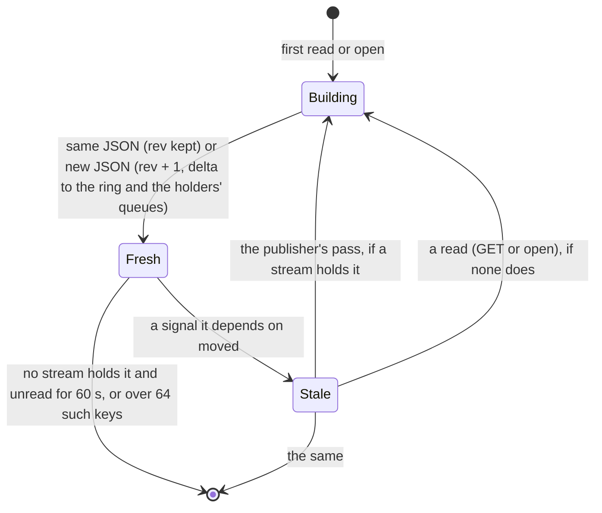
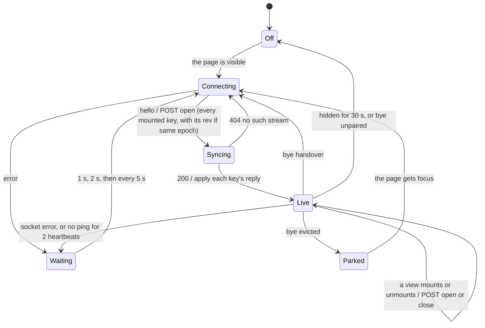
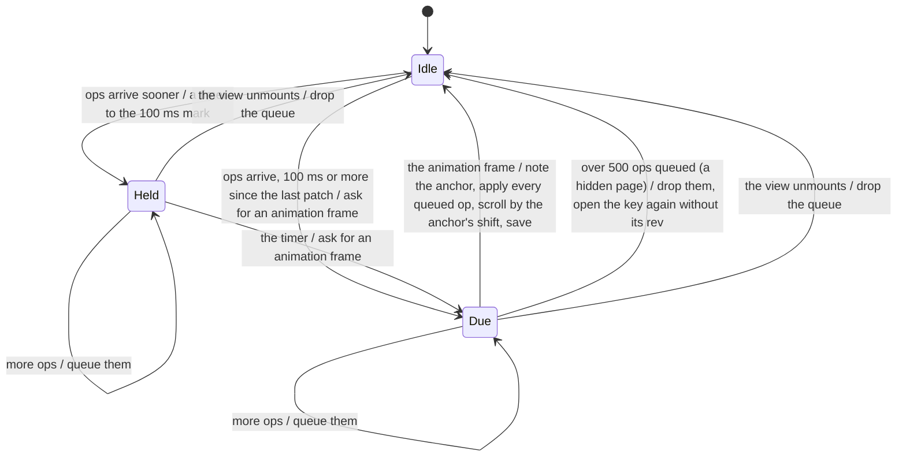
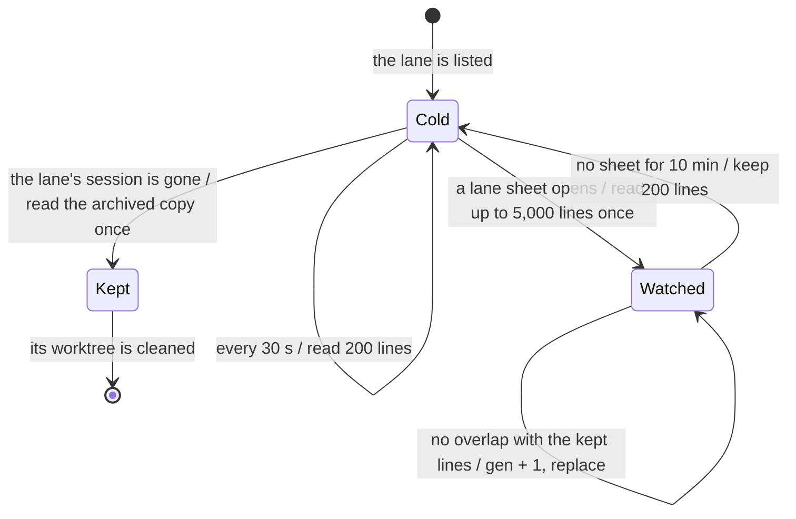

# screen-hub: module boundaries and the statecharts (#1318)

## The crates

```
drover-blocks   (serde, serde_json)        no drover crate, no tokio, no clock, no socket
      ▲
drover-server ──> drover-core ──> drover-sys          tokio: server and service only
      ▲
drover-service ──> the `drover` binary
```

`drover-blocks` is the renderer core (q2040). Only `drover-server` depends on it and re-exports it as
`drover_server::blocks` for the tests. It could leave the repo with a change of its package name. core does not
see it and does not see tokio. Enforced by two bans in `.drover/arch.toml` and CI's layers step (`adr.md`).

## Who may call whom

```
socket ──> conn (accept, read, route) ──> stream ──> hub ──> screens (builders) ──> tails ──> core::session::transcript
                 │         │                          │  └──> blocks (Shelf, diff)     └────> core (events, config, gh cache)
                 │         └── GET /screens/<x> ──────┘
                 └── every other route ──> spawn_blocking ──> serve.rs `respond` (today's handler)
page:  main.ts ──> stream.ts ──> patch.ts ──> blocks.ts (render one block)
```

| Module | Owns | May call | Must not |
|---|---|---|---|
| `drover-blocks` (new crate) | `Screen` and its faults, `Op`, `ops`, `apply`, the wire types, `Shelf`, `Mirror` | serde, serde_json | name a drover type, a path or a screen; read time, files or config; do I/O; render |
| `serve/conn.rs` (new) | the runtime, the accept loops, the request reader and its limits, the split of routes, the two semaphores | `stream`, `Hub::read`, `Server::respond` in `spawn_blocking` | build a response body itself; block the runtime (no SQLite, shed, file or subprocess outside `spawn_blocking`) |
| `serve/hub.rs` (new) | `Hub`, `Key`, `Signals`, `Deps`, single flight, the publisher's task and its pass, per-key build times and faults for `/api/v1/health` | `blocks::Shelf`; in `spawn_blocking`: `screens::build_screen`, `screens::deps`, `db::last_seq`, `db::stamp`, `Fresh` (its counter), `Tails` (a lane's generation), `conductor::mark_read` after building a thread key a paired stream holds | write to a socket; know a device; diff or keep revs itself (the `Shelf` does); build outside `runner::request` (a build never starts a process) |
| `serve/stream.rs` (new) | sessions, the per-device limit, a stream's `Queue` and writer task, the `POST` sync, cooee's one-key stream in the old ops, `/live`'s writer | `Hub::open`, `Hub::close`, `Hub::read`; `devices::check` in `spawn_blocking`; `Tails::watch` when a lane sheet key opens | build or diff a screen; keep anything after its socket closes |
| `serve/tails.rs` (new) | `Tails`, the feeder thread, line numbers, `page` | `session::transcript` through `hosts::On` and the runner (off the request path), `lanes::mask`, `Hub::kick` | be read from shed on a request; render blocks |
| `screens.rs` | the builders, `deps`, the actions | `Tails::tail`, the rest as today | hold a stream, a counter of streams or a diff (`stream`, `STREAMS`, `ops` leave); mark a thread read inside a build |
| `serve.rs` | `Server`, `respond` and its routes, the background threads | `Hub::kick` after a write | accept or read a socket (`handle` leaves for `conn.rs`); call `build_screen` (the static export, in `screens.rs`, is the one caller besides the hub) |
| `api.rs` | serve's payload types; re-exports the crate's wire types | `blocks::wire` | define a second `Op` or `Frame` |
| `stream.ts` (new, in `web/src`) | the one `EventSource`, `hello`, the sync `POST`, revs, gaps, backoff | `fetch` | touch the DOM |
| `patch.ts` (new, in `web/src`) | the op queue and its 100 ms pacing, ops onto a view (its model by id, its nodes by `data-id`), the anchor, the debounced save | `blocks.ts` `render` for one block | clone a model; call `paint`; touch a node no op names |
| `main.ts` | views, tabs, sheets: `mount`, `unmount` | `stream.ts`, `patch.ts` | open an `EventSource`; fetch a screen while the stream is live |

## What runs where, after the change

| On the runtime (tasks) | In `spawn_blocking` | On a thread of its own |
|---|---|---|
| the accept loops (page, webhooks) | `Server::respond`: every route but the stream's two and a fresh screen | the host sampler |
| one task per connection: read, route, write | a build (the publisher's pass; a read of a stale unheld key) | one per background read (`fresh::Source`) |
| `GET /stream`: a writer task per stream | `devices::check` | the 1 s tick, the 60 s SLO pass |
| `POST /stream/<sid>`, `GET /screens/<x>` when fresh | | the tap jobs |
| the publisher's loop | | the lane tail feeder (new) |

The per-connection threads, the per-stream build loop and its 500 ms poll go. `thread::scope` goes with them: the
threads hold the `Arc<Server>`.

## A cache entry (the hub)



A second reader of a key that is `Building` awaits that build. Signals that move during a build leave the entry
`Stale`, and the next pass builds once more: at most one build of a key at a time, and the newest signals win.

## The device stream, on the page



The sync dot: green in `Live`, amber in `Connecting`, `Syncing` and `Waiting`, red when offline or `Parked`. A tab
the owner has opened stays mounted while the page is visible, so its badge is live and switching to it needs no read.

## A view's patches, on the page (q2039)



The anchor is the first node with an id in view that the queued ops neither move nor remove. With the scroller at
its top there is no anchor (a new first row shows). A `log` container at its end has no anchor either: it stays at
its end.

## A stream, on the server

```mermaid
stateDiagram-v2
    [*] --> Attached: GET /stream (allowed host; device or peer known)
    Attached --> Attached: POST / subscribe, unsubscribe, reply with each key's state
    Attached --> Attached: the hub publishes a key it holds / queue a frame
    Attached --> Lagging: queue over 64 frames or 1 MB / drop the queue
    Lagging --> Attached: the writer catches up / each held key's next frame is a whole screen
    Attached --> [*]: socket error, a write not taken in 2 heartbeats, evicted, device unpaired, handover
    Lagging --> [*]: the same
```



Closing a stream drops its subscriptions. Nothing is kept for it.

## A lane's tail



Remote lanes are read in one call per host per round, as the snapshot does.
