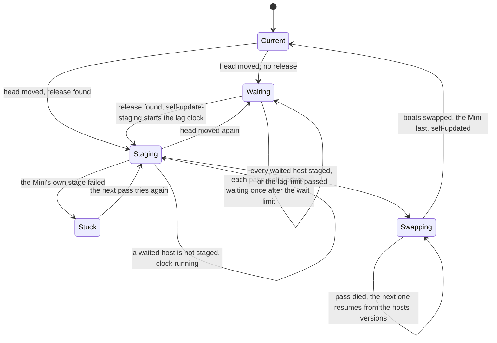
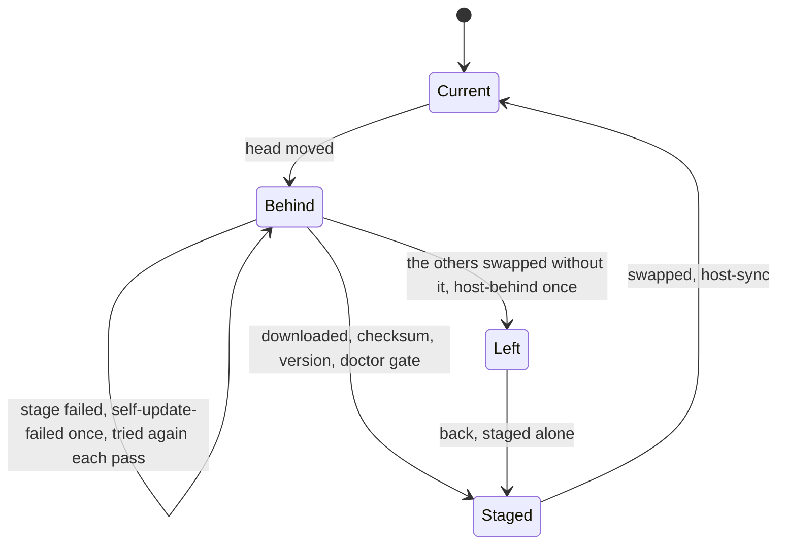

# self-update: prebuilt signed builds, staged on every host, swapped together (#1275)

## Summary

Decision: CI builds, signs and publishes every green main and staging build as a GitHub release. The 5-minute self-update job becomes the only installer: in one pass it downloads and checks the build on every host, then swaps the boats and the Mini last. A host on another build is passed over quietly until it is caught up. Nothing builds drover from source.
Slices: 1 the release workflow (build, sign, notarize, publish, prune), 2 the one install path (download, checksum, version, doctor gate, swap), 3 the staged rollout with the 30-minute lag rule and the quiet skip, 4 the source build and local signing removed, the docs on one page.
Open questions: (1) Keep the signing secrets in a GitHub environment limited to main and staging, not as plain repo secrets? Any PR branch's workflow can read a plain repo secret, and lanes push PR branches. I recommend the environment. (2) `self-update-waiting` alerts after 45 minutes without a build, because every promotion waits about 20 minutes for CI anyway; say if you want it at once. (3) The AC's plain `spctl -a -vv` rejects every bare command-line binary, notarized or not (measured); the check becomes `spctl -a -vv -t install`.

Read this file, then `adr.md`. `shapes.md`, `boundaries.md` and `facts.md` are for the impl lane and the reviewer.

## A promotion, pass by pass

| When | What happens | Builds running |
|---|---|---|
| main moves to N | CI runs. The pass prints "waiting for build-N" and changes nothing. | every host: M |
| CI green, about 20 min | The release workflow builds both targets, signs and notarizes the macOS one, publishes `build-<sha7>`. | every host: M |
| the next pass, 5 min at most | The Mini reads `SHA256SUMS` once. Each host that is up downloads its asset to `drover.new`, checks the checksum, checks `--version` names N, runs the doctor gate. All staged: the same pass swaps the boats, then the Mini, then runs `profiles sync` and hands serve over. | M, then N within seconds |
| a host is off or its stage fails | Nobody swaps. 30 minutes after staging began, the rest swap without it; one `host-behind` event; it takes no new lanes and its running lanes finish. | the rest: N, it: M |
| it is back | A later pass stages and swaps it alone; lanes go there again. | every host: N |

A boat that is stopped (a cloud host with no lane) is not waited for: it is left behind at once and caught up when it
starts. Without this every promotion would wait 30 minutes for boats that are asleep.

## How the callers read

The job, one pass over one target (the live install over every host; the staging serve over the Mini alone):

```rust
let head = head(r, f, t.branch)?;
let found = release::find(r, &f.repo, t.branch, &head);
let mut members = members(ctx, cfg, r, &t);
if let Found::Release(rel) = &found {
    for m in members.iter_mut().filter(|m| m.needs(&head)) {
        m.staged = stage(ctx, cfg, rel, m);
    }
}
match step(ctx.now, &head, &found, &members, &marks(&events, &head), &cfg.limits) {
    Step::Current => say(out, "up to date"),
    Step::Wait { alert } => waiting(ctx, cfg, &head, alert),
    Step::Hold { missing, until } => say(out, &held(&missing, until)),
    Step::Stuck => {}
    Step::Swap { ready, behind } => swap(ctx, cfg, r, &t, &ready, &behind)?,
}
```

`step` is a pure function of the hosts' versions, the release and a few marks in the log, so a pass killed anywhere
resumes from what is on the hosts.

Placement passes over a host the log says is behind or mid-swap, with no ssh:

```rust
let behind = machine.and_then(|_| updating(pre.0, name, ctx.now));
Ok(_) if behind.is_some() => (Host::default(), behind.map(|w| ("HOST_UPDATING", w))),
```

Spawn's live guard keeps refusing a lane on another build, but a build difference is no longer `ACP_UNGUARDED` and
no longer marks the host sick:

```rust
match hosts::acp_guard(ctx, on, home, (&p.profile, p.family, id)) {
    Ok(()) => {}
    Err(Unguarded::Build { theirs, mine }) => return refused("HOST_UPDATING", skew(&pl.name, &theirs, &mine)),
    Err(why) => {
        hosts::sick(ctx, &pl.name, &format!("✗ acp guard {} — {why}", p.profile));
        return refused("ACP_UNGUARDED", format!("{}: {why}; the lane does not start", pl.name));
    }
}
```

`hosts bootstrap`, and a cloud host's start, install this build the same way:

```rust
steps += &format!("drover\t{check}\t{}\n", release::stage_line(&asset, &exe) + " && " + &release::swap_line(&exe));
```

What the owner sees:

```console
$ drover self-update --dry-run
main @ 0123abc: build-0123abc found
  mini        bd6ba01                  would stage, swap last
  boat-dev-1  bd6ba01                  would stage, swap
  boat-dev-2  bd6ba01, staged 0123abc  would swap
  boat-dev-3  stopped                  not waited for; caught up when it starts
  boat-dev-4  unreachable              waited for until 14:32, then left behind
then: profiles sync, serve handed over
```

## State

One rollout, per head:



One host:



`Behind` and `Staged` hosts still run the Mini's build, so they take lanes as usual. Only `Left` (and every remote
host for the seconds of `Swapping`) answers `HOST_UPDATING`.

## The AC, mapped

| AC | Met by |
|---|---|
| a green main push creates `build-<sha7>`, a green staging push a prerelease, prereleases over 14 days go | slice 1; seen on staging before the promotion (owner step 2) |
| the macOS asset is Developer ID signed and notarized | slice 1's verify step: `codesign -dv`, `codesign -v -R=notarized --check-notarization`, `spctl -a -vv -t install` (open question 3; a bare binary cannot be stapled, so the notarization is recorded) |
| 3 hosts staged and 1 not: no swap before 30 min, then three swap, the fourth skipped with one event and no `ACP_UNGUARDED` | slice 3: `Step::Hold` then `Step::Swap`; `host-behind`; `HOST_UPDATING` |
| no release: nothing built, one `self-update-waiting`, retried | slice 3: `Step::Wait`; the test's clock is past the wait limit |
| a bad checksum or a wrong version sha leaves the live binary untouched, logs `self-update-failed` | slice 2: only `drover.new` is ever written before a swap; slice 3 logs once per host and sha |
| the next promotion shows no version-skew refusals | slices 3 and 4, from the second promotion on (owner step 3) |

## Slices, in order

1. **The release workflow.** A new workflow file and one signing script; `ci.yml` is not edited. Nothing reads its
   releases yet, so it is proven on staging first.
2. **The one install path** (new `core::release`): find a release, read a host's builds, stage, swap. `hosts
   bootstrap` uses it; `install_line` goes.
3. **The rollout** (`update`): members, `step`, the swap, the events; `hosts::sync` goes and the survey only reads
   versions; `HOST_UPDATING` in placement and in spawn's guard; four `[limits]` keys.
4. **Removal and docs**: the cargo build and the "drover-local" gate in `update`, scripts/install-gate.sh, the
   reinstall line `drover merge` prints, doctor's signature row (Developer ID); one new docs page for releases and
   updates, linked from the two sections it replaces in `docs/setup.md` and `docs/hosts.md`.

One PR, four commits.

## Owner steps (the PR's `## For humans`)

1. Before the PR merges: create the `release` environment (branches main and staging) and set the five secrets
   named in `shapes.md`. The lane never sees their values.
2. After it merges, before any promotion: wait for one `build-staging-<sha7>` prerelease and run the three verify
   commands on its macOS asset. A promotion before this leaves the boats behind until the workflow works.
3. The first promotion is the last source build: the Mini's old updater builds it, and the boats are passed over
   quietly until `build-<sha7>` is out, then install it. From the second promotion on there is no skew. The Mini
   gets its first Developer ID build at the second promotion: re-approve each keychain prompt once then.
4. Afterwards, delete the old build folders under the state directory (`update/src`, `update/target` and the same
   two under `update-staging`): several GB.
