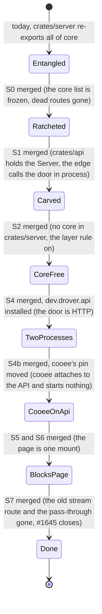
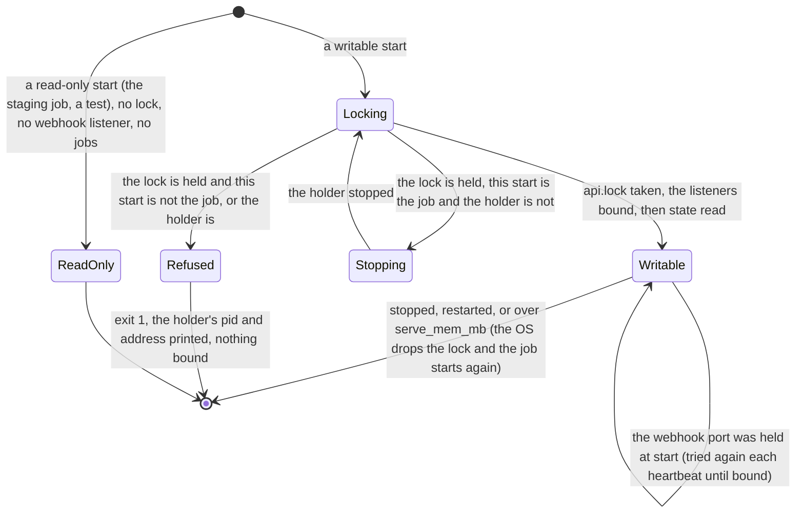
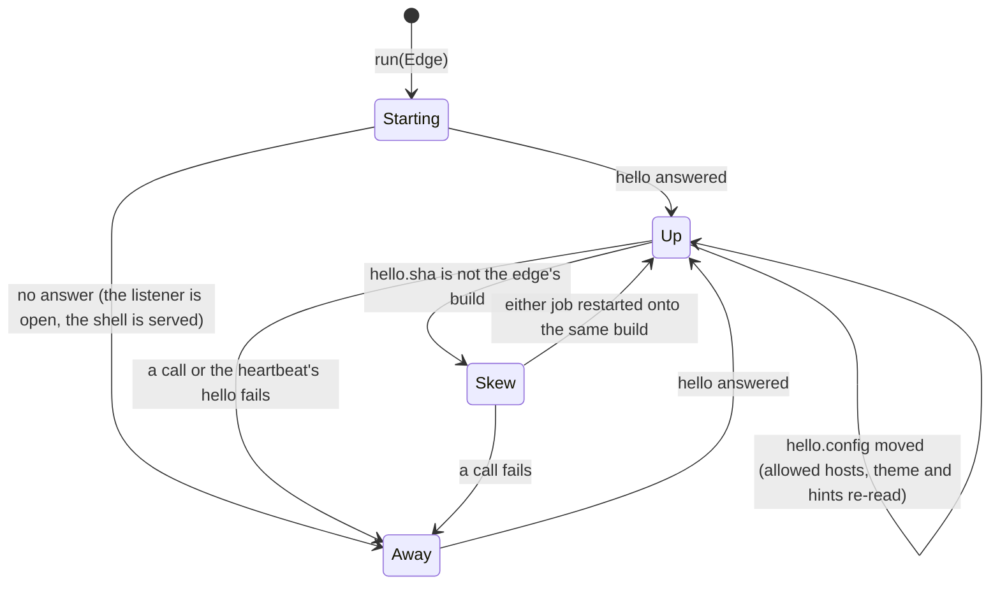
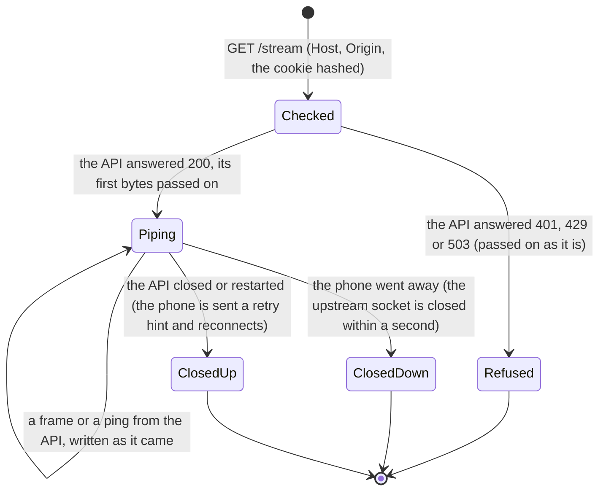
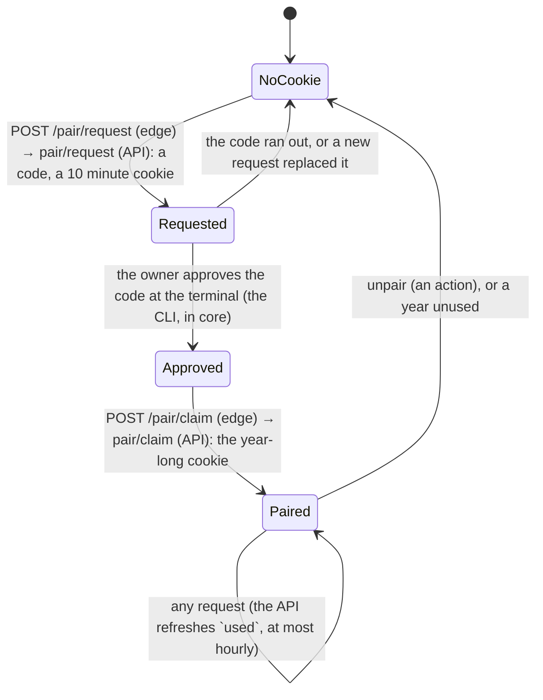

# serve-split: module boundaries and statecharts (#1645)

## Who may call whom

```
phone, browser ──HTTP──▶ server (the edge) ──Engine──▶ the door ──HTTP, serve-token──▶ api::host
an agent ──/mcp, its key──▶ server (one line: the key hashed into Drover-Key) ──same door──▶ api::host
an agent on the host ──/mcp, its key, loopback───────────────────────────────────────▶ api::host
cooee ──HTTP, cooee-token (attach only: it starts nothing)───────────────────────────▶ api::host
GitHub ──POST /hooks/github (its own listener, bound by the one writable host)───────▶ api::host
drover chat, the tests ──in process──▶ api::Local, api::serve::Server::respond
                                                         │
                                                         ▼
                                   api (routes, screens, hub, tails, jobs) ──▶ core ──▶ sys
cli (the launcher) ──▶ server::run(Edge)      cli ──▶ api::host      cli ──▶ core
server, api ──▶ wire (HTTP only)              server ──▶ sys (the listeners' file descriptors)
```

| Crate or module | Owns | May call | Must not |
|---|---|---|---|
| `server` (the edge) | the page's listener and the device listener; the shell and the embedded files; themes; the Host and Origin check; the `hd` cookie; the relay; the handover; its own `/health` | `wire`, `sys`, `blocks` and `swag` (theme rules), the `Engine` it was given | link `core` or `api`; read fleet.toml, the environment or the database; start a process; decide who is paired or what a device may do; keep a screen, a revision or a device list; parse a relayed body |
| `server::engine` | the `Engine` trait, `Request`, `Reply`; from S4 the `Http` door | `wire`'s client | name an API path outside `relay.rs` and the four the edge asks itself (`hello`, `layout`, `device`, `pair/*`) |
| `api` | every route a client may call; `Viewer` from the token and headers; paired-only and read-only refusals; send and stream limits; screens, the chat screens, actions; the hub and the device stream; the tails; the jobs; the lifeboat's HTML; the webhook listener; `Local`; the payload types | `core`, `wire`, `blocks` | build the page shell or serve a page file; check Host or Origin; call the edge; trust a `Drover-*` header that came without the edge's token |
| `api::host` | the `api` command: `api.lock`, the loopback listener, the webhook listener, the tokens, the background readers, the sampler, the memory limit | `api`, `core` | bind a non-loopback address for the API; bind the webhook listener or run a job without the lock |
| `api::serve::mcp` (#1627) | `/mcp`: the tools, the sessions, the key lookup | `api`'s routes and verbs, `core` | hold logic of its own behind a tool; read a key anywhere but the bearer (loopback) or `Drover-Key` (beside the edge's token) |
| cooee (another repo) | drawing drover's screens, the chat (#1571) | the API's address, with `cooee-token` | start a drover process; attach to the edge (from S4b) |
| `wire` (S4) | accept, read a request, write an answer, gzip, a stream's frames; the loopback client | `tokio`, `flate2` | link any drover crate; know a path |
| `core` | state, gates, verbs, `devices`, `thread` (#1571) | `sys` | link `api`, `server` or `cli`; name a screen |
| `cli` | the `drover` binary: the `serve` launcher (config to `Edge`, the held-port rule, the successor), `api`, `serve approve|pending|devices`, `serve --export` (both crates' files) | everything | hold route or screen logic |
| `chat` (the terminal) | the Board and Threads tabs | `api::Local`, `core` | open a socket to drover; link `server` |
| `service` | the drive loops, the links, the kicks | `core` | link `api` or `server`; host a board |
| `web/src` (the page) | from S5: the `mount` call, `layout.json`'s use, the scene, pairing, alerts until #1571's D4, timings | the blocks package; the edge's paths | name an `/api/v1` read; define an op, a frame or a patch |

The bans and layer rules in [adr.md](adr.md) hold the last column wherever a pattern can. The rest is the `edge`
test: it runs the edge against a door that only replays the contract folder's recorded answers, so a need outside
the contract has nothing to answer it.

## The migration



Every state runs and ships. Up to `CoreFree` it is still one process: going back is a revert of one PR. S3 (the
device stream) lands anywhere after `Carved` and before `BlocksPage`; S5 and S6 may land before `CooeeOnApi`. In
`TwoProcesses`, a host whose `dev.drover.api` is not installed yet has an edge that answers `BUSY`: S4's rollout
note is `drover timer install`, and `drover check` revives the job like serve's.

The one swap that crosses layouts is S4's. The new API host starts while the old one-process serve still holds
the webhook port. It serves without the port, logs so, and tries the bind again each heartbeat until it has it.
The new edge then asks the old serve to hand over; the launcher keeps the page's and the device listener and
closes the webhook socket it is handed, and the API host's next try takes the port. From `TwoProcesses` to
`CooeeOnApi`, cooee is still attached to the page's port and its `run` line can still start an edge there, never
an API: an edge binds no webhook listener.

## The API host



At most one process is in `Writable` for a state folder, and only that state has a webhook listener. cooee, the
edge and the service have no arrow into this chart: none of them starts the `api` command.

## The edge's link to the API



`Away`: a relayed request answers 503 `BUSY`, a stream ends with a retry hint, the shell and the page's files are
still served, and the page paints its last copy. `Skew`: everything works (the contract only grows); `/health` and
doctor show both builds. The edge never restarts itself over a build difference: self-update restarts the jobs,
API first.

## A relayed stream



The edge holds one upstream socket per stream and nothing else. Which keys are open, the revisions, the queue's
bounds and the four-streams-a-device rule are the API's, keyed by the `Viewer`. A reconnect after `ClosedUp`
resumes by revision, as after any restart.

## A device



The states live in drover's `devices` table, as today. The edge's only part is to carry the cookie: it sets the
value the API hands it and sends its hash back. `Open` in the API's `Viewer` is every state but `Paired`.
