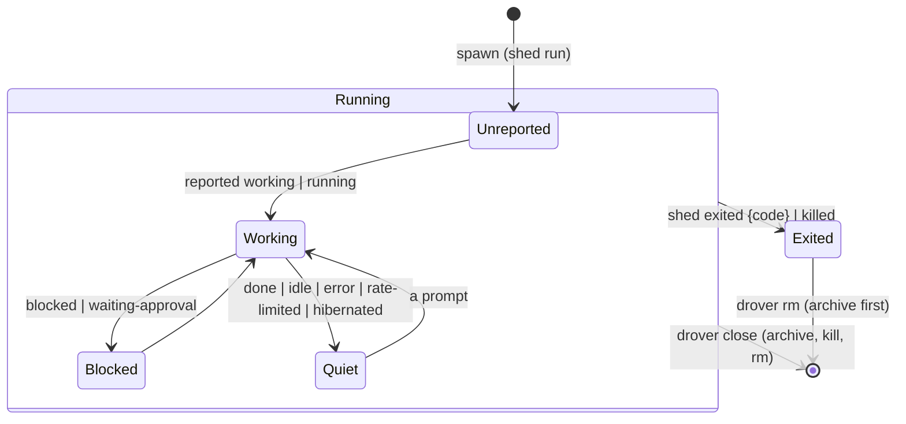
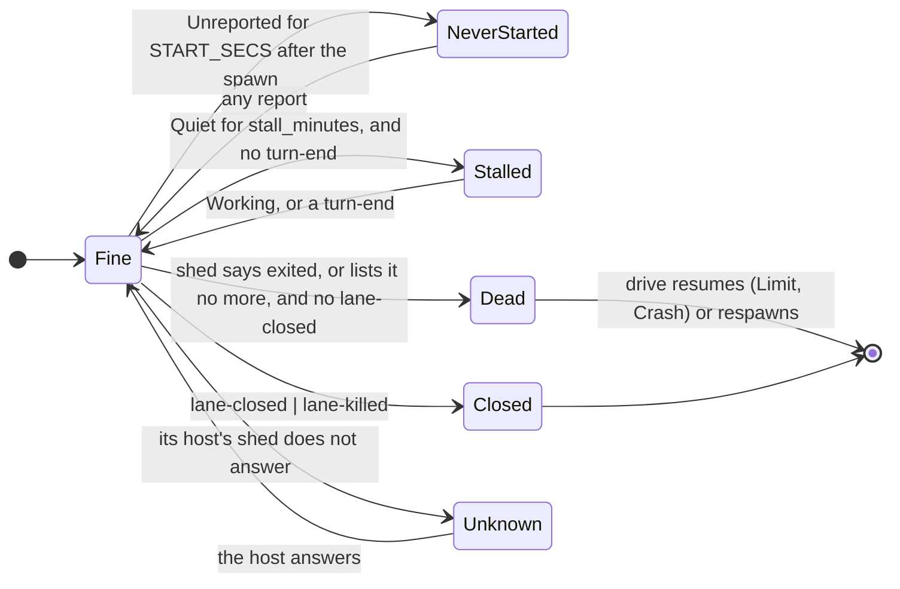

# shed-native: module boundaries and the statechart (#1053)

## Who may call whom

```
shed (wire)  <──  session (what shed says)  <──  lanes (what it means for a lane)  <──  check, drive, stall,
     ^                    ^                                                            waiting, gate, spawn,
     └──── term (writes) ─┘                                                            design, orchestrator,
                                                                                       hosts, snapshot, server
```

| Module | Owns | May call | Must not |
|---|---|---|---|
| `shed` (`crates/core/src/shed.rs`) | the wire: `call`, `follow`, `cli`, `Wire`, the pinned rev | the runner | know a lane, an issue or the log |
| `core::session` (new) | `Session`, `Status`, `Exit`, `Pulse`, `Transcript`; the one mapping from shed's types; the `lane-state` stamp; the transcript archive | `shed`, `events` (append and read `lane-state` only), `config` (hosts) | read an issue's state, a turn-end or git; call `term` |
| `term` (`crates/core/src/term.rs`) | writes: run, send, keys, wait, kill, rm; `read_argv` for setup and the TUI kicks | `shed`, `session::get` (ACP or not, asleep or not), `session::transcript::archive` before a kill | list sessions, map a status, expose a row of JSON |
| `lanes` (`crates/core/src/lanes.rs`) | `Lane`, `LaneState`, `Health`; `join`, `health`, `orphans`; masking | `session` (types and `since`), `events`, `waiting::turn` (a pure log read), git through the runner (parked) | call `shed` or `term`; read a screen |
| `stall`, `check`, `drive`, `waiting`, `gate`, `spawn`, `design`, `orchestrator`, `hosts`, `slo`, `snapshot` | what drover does about a lane | `session::all` / `observe` once per pass, `&Sessions`, `lanes::health` | name a shed wire type, compare a status as a string, read a screen for a fact |
| `providers` | launch, hooks, login, accounts | as today | take a screen: `status_word`, `now_line`, `tool_line`, `pending_menu`, `answer_keys`, `usage_limited`, `signed_out`, `cap_banner`, `transcript` leave the trait |
| server (`serve.rs`, `serve/v1.rs`, `screens.rs`) | rows, sheets, API shapes | `lanes::join`, `session::transcript`, `session::all` behind its caches | write a `lane-state` (a read never stamps); read a screen but setup's |

`observe` has three callers and no others: drive's pass, `drover check`, and the service's event follower
(through `on_event`).

## A session's states (shed's), and what drover adds





Rules the charts fix:

- **Quiet with a turn-end is never a stall.** `done`, `blocked` and `need-input` hand the issue to drive or the
  owner (`waiting::turned`, unchanged); `working` gets its one "continue" prompt after the threshold, unchanged.
- **Blocked is never a stall.** It has its card; today any status but `working` could stall.
- **The stall clock starts at shed's change** (`lane-state.since`), not at the issue's last drover event.
- **Unreachable is never dead.** A host whose shed fails gives `Unknown`; only `Absent` on a host that answered,
  or `Exited`, is `Dead`.
- **Dead needs no event.** The poll reads `exit` and the last `reported` from the exited session itself, so a
  lost `exited` event (drive off, too far behind shed's kept events, a remote host) still gives the cause.
- **What drover does next is unchanged**: respawn once then `LANE_STALLED`; resend the brief, respawn, then
  `START_FAILED`; resume a `Limit` or `Crash` exit in the same worktree (#662); `LANE_ENDS` otherwise.
