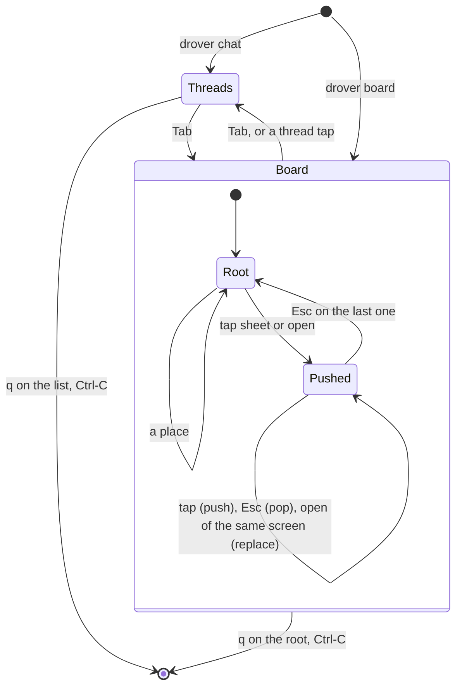
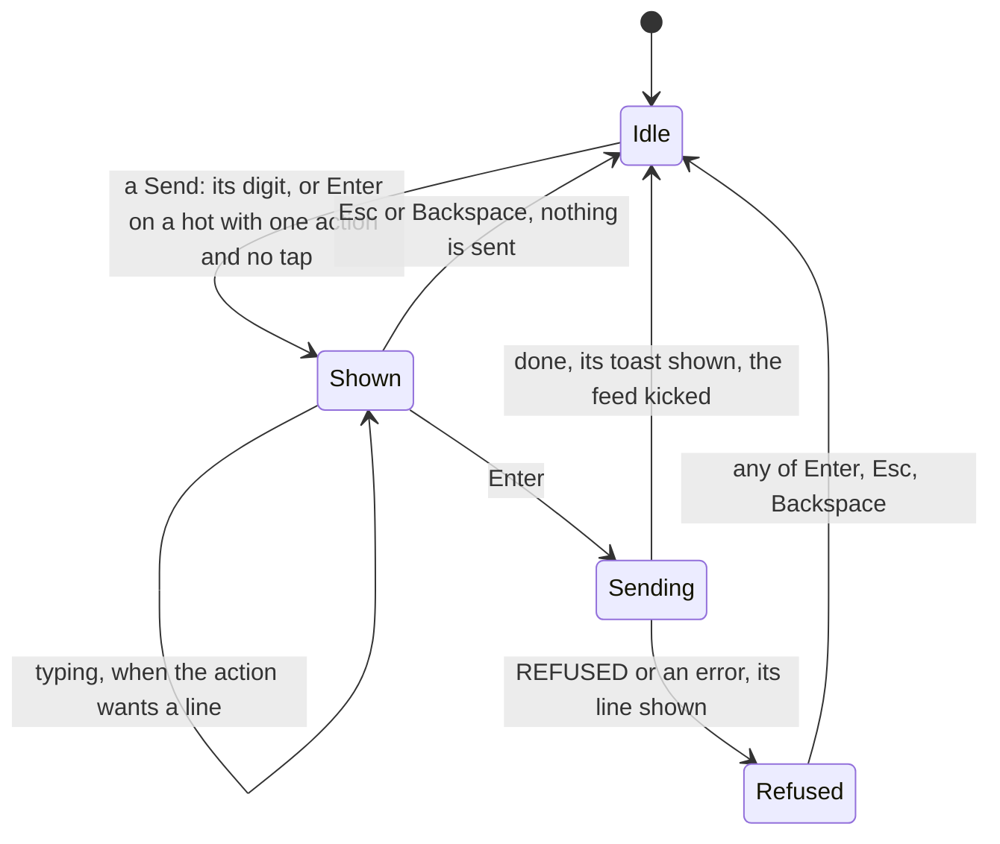
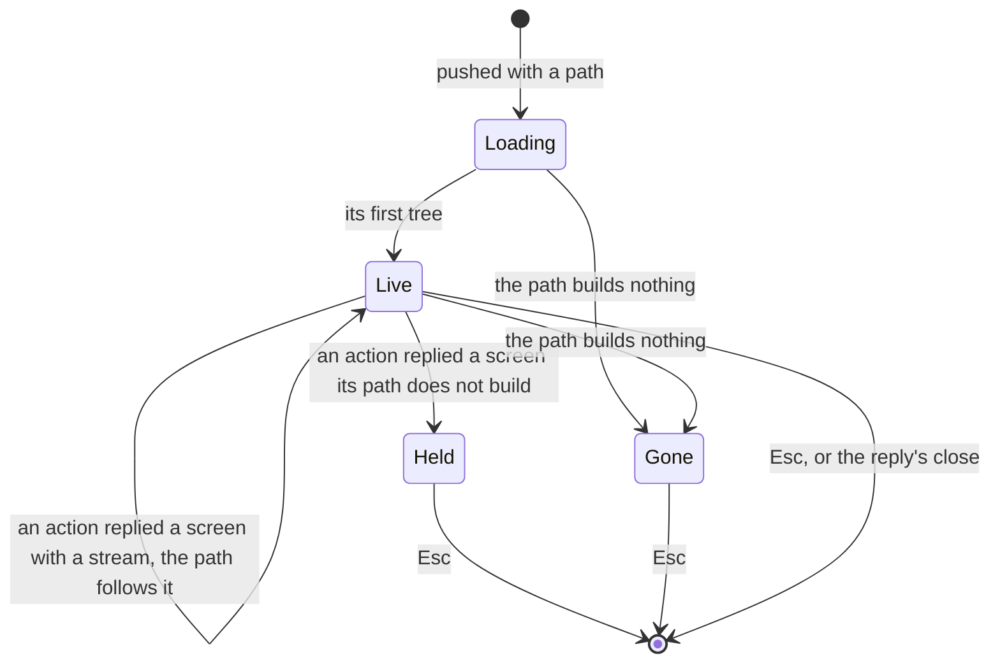

# Terminal board: data shapes and statecharts (#1354)

## Core: which tab to open

```rust
pub enum Open {
    Threads(Option<String>),
    Board(Option<String>),
}

/// The full-screen app, set by the binary; `Ok(false)`: stdout is no terminal, nothing was drawn.
pub static APP: OnceLock<fn(&Ctx, &dyn Runner, &Open) -> Result<bool>> = OnceLock::new();
```

`APP` replaces `CHAT`; its one caller moves with it.

## Server: the door

```rust
pub struct Local<'a>(Server<'a>);

pub struct Place {
    pub label: String,
    pub subtitle: String,
    pub path: String,
    pub root: bool,
}

pub struct Done {
    pub toast: String,
    pub close: bool,
    pub screen: Option<Value>,
}

pub(super) enum Who<'a> {
    Device(&'a str),
    Plugin,
    Local,
}
```

- `Place.root`: a header-strip place (Queue, Events, Lanes), one of the Board's root screens. Else a menu row,
  opened as a sheet (Fleets, Hosts, Workflow).
- `Done.screen`: the tree of the reply's `screen` op, pruned, when there is one. The other ops are dropped at the door.
- `Who` is who runs an action. It decides the permission set (`Plugin`: the manifest only; the others: the manifest
  plus the thread and host actions) and the `by` of a `later`. `Server::perform(ctx, who, body)` takes it; the HTTP arm
  builds `Device` or `Plugin`, the door `Local`.
- The door refuses `secret-card` with `act: save` as `NOT_PERMITTED`: a secret is entered on a paired device.

The action body is the phone's, unchanged:

```json
{"screen": "queue", "block": "q-herdsman-1354", "action": "move",
 "values": {"fleet": "herdsman", "issue": 1354, "before": 1320}}
```

## The screen tree, as the renderer reads it

A tree is the `serde_json::Value` the builders return; the app defines no type per block. Four rules cover it:

```rust
pub const TEXTS: [&str; 17] = [
    "title", "badge", "value", "subtitle", "meta", "header", "label", "markdown", "text",
    "command", "dir", "touches", "sha", "source", "alt", "placeholder", "footer",
];
pub const KIDS: [&str; 6] = ["blocks", "rows", "fields", "buttons", "items", "options"];
```

- `TEXTS` is what a block of an unknown type draws, in this order; `KIDS` is where its children are.
- A text value is a string, a `{text, tone}` object, or a ticking object (`{since}`, `{since, label}`,
  `{until, label}`).
- A block is an object with a `type`. Its identity is its `id`, a field's is its `name`, and one with neither
  takes its position in its parent.
- `tap`, `action`, `values`, `confirm`, `swipe`, `fold`, `done`, `submit`, `other`, `default`, `more` and `stream`
  mean what `web/src/blocks.ts` and `web/src/main.ts` make of them; adr.md lists each.

## App: the frame

```rust
enum Tab {
    Threads,
    Board,
}

pub struct App<'s, 'e> {
    tab: Tab,
    threads: Threads<'s, 'e>,
    board: Board<'s, 'e>,
    health: Health,
    pub quit: bool,
}
```

`Threads` is today's `App` without the frame's fields. `Health` is today's serve and shed check, with its top line.

## App: the Board

```rust
struct Board<'s, 'e> {
    places: Vec<Place>,
    root: usize,
    cards: View,
    stack: Vec<View>,
    pick: Option<Pick>,
    said: Option<Said>,
    feed: Sender<Ask>,
}

struct View {
    from: Source,
    sheet: bool,
    tree: Tree,
    ui: Ui,
}

enum Source {
    Live(String),
    Held,
}

enum Tree {
    Loading,
    Shown(Value),
    Gone,
}

struct Ui {
    sel: Option<String>,
    top: usize,
    open: BTreeSet<String>,
    edits: BTreeMap<String, Value>,
    editing: Option<String>,
}
```

- `stack[0]` is the root place's screen and is never popped; a place key swaps it.
- `Ui` is keyed by block id and field name, never by index: `sel` the hot under the cursor, `open` the unfolded
  cards, `edits` the fields changed and not yet sent, `editing` the text field being typed in.
- When `sel` names a hot that is gone, the cursor takes the hot at the same position.

## App: what `lay` returns

```rust
struct Laid {
    lines: Vec<Line<'static>>,
    hots: Vec<Hot>,
}

struct Hot {
    id: String,
    at: Range<usize>,
    tap: Option<Tap>,
    acts: Vec<Act>,
}

enum Tap {
    Sheet(String),
    Open { path: String, keep: bool },
    Thread(String),
    Show(String),
    Fold,
    Edit,
    Root(usize),
}

struct Act {
    label: String,
    tone: Tone,
    does: Does,
}

enum Does {
    Send { send: Send, confirm: Option<Confirm>, typed: Option<Typed> },
    Set { name: String, value: Value },
}

struct Send {
    screen: String,
    block: Option<String>,
    action: String,
    values: Map<String, Value>,
}

struct Confirm {
    title: String,
    message: String,
    ok: String,
}

struct Typed {
    key: String,
    placeholder: String,
}
```

- Enter on a hot follows its `tap`. A digit takes `acts[digit - 1]`. A hot with no `tap` and one act takes it on
  Enter too.
- `Tap::Show` is a `url` or a `copy`: a panel with the text. `Fold` opens or closes a folded card, `Edit` a text
  field, `Root` a place; these three are the app's own and send nothing.
- `Does::Set` is a local edit (a toggle, a picker option): it applies at once, with no panel. `Does::Send` opens
  the panel and is the only way anything leaves the app.
- `Typed`: the action wants a line first (a choice's `other`); it goes into `values` under `key`.
- `Send` is built by `lay` from the tree, the view's `edits` included. No other code makes one.

## App: the pick, the feed's messages

```rust
struct Pick {
    act: Act,
    typed: String,
    state: Picked,
}

enum Picked {
    Shown,
    Sending,
    Refused(String),
}

enum Ask {
    Watch(Vec<String>),
    Kick,
    More(String),
}

enum Note {
    Tree(String, Option<Value>),
    Page(String, Option<Value>),
    Done { done: Done, live: bool },
    Refused(String),
    Health(Health),
}
```

- `Ask::Watch`: the paths of the views on screen; the feed builds no other.
- `Note::Tree(path, None)`: the path builds nothing; its view turns `Gone`.
- `Note::Done.live`: for a reply with a `screen` op and no `stream`, whether the view's own path builds that same tree.
- `Said` is the last toast or refusal, shown on one line until the next key.

## Statecharts

The app and the Board's stack:



One action (the two presses):



Esc while `Sending` hides the panel only: the action runs on and its result shows as the toast line. A second
action cannot start until the first has ended.

One view:


