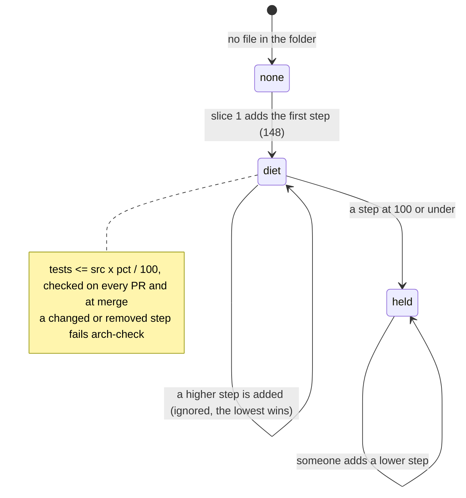
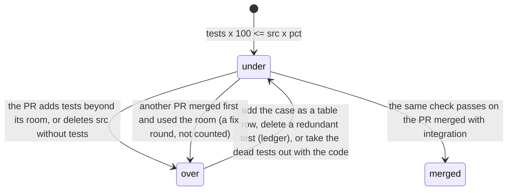
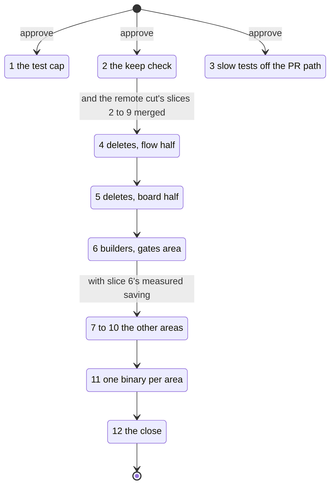

# test diet: who may call what, and the statecharts (#1760)

## Module boundaries

### Tests

```
 a test file  ──▶  common: World, Client, Repo, Log, Hook   ──▶  the crate's entry points
 (one area)        common: Fake, FakeShed (the scripted runner       drover::main_with (the CLI, in process)
                   and shed, behind the builders)                    serve::Server (a request, a stream)
                                                                     events: the log read back
```

| Module | May call | May not |
|---|---|---|
| A test file of an area | `common`'s builders; the crate's public entry points; a pure public function when no outer test shows its result (a table, with the reason in the PR body) | another area's files; a runner, an HTTP client, a git repo builder or a log reader of its own (slice 12's bans); the text of a src file |
| `common` | the crate's public API; `std` | assert anything: a builder builds and reads back, the test asserts |
| `sim/` | its own world and scheduler; `drover::sim::Hooks` | the builders of `common`: it simulates the world itself and stays apart |
| A `nightly` module | whatever its file may | exist without a smaller check of the same rule on the PR path |
| A table test | one arrange function per row | hide a row's name: the label is the old test's name and is printed on failure |

Layers of assertion, outermost first. A behaviour is asserted at the first layer that shows it, once:

1. the CLI verb or the drive pass: exit code, output, the events it logged;
2. an API route or a screen: the JSON the server builds;
3. a client: how the page, the terminal board or cooee draws that JSON. Those tests belong to the client
   (#1759, #1755, #1665), not to a second copy beside the server's;
4. a pure function: only as a table, only when layers 1 to 3 cannot show the value.

A second assertion of the same behaviour at an inner layer is a duplicate. A second assertion through another
transport that ends in the same handler is a duplicate; through a different handler it is not.

### The cap

```
 CI lint job ─┐
 merge check ─┼─▶ the cap check ─▶ reads ci/cap.toml, ci/cap.d, ci/test-cap.d ─▶ counts src and tests on disk
 done gate   ─┘        (drover's cap-check today; gatekeeper's core/cap after #1643)
 arch-check ───▶ append_only: a step is never changed or removed
```

| Module | May | May not |
|---|---|---|
| The cap check | read the three places; count files on disk; print and exit 1 | read git for the test rule (the ratchet needs no base: the folder's lowest step is the whole state); write anything |
| arch-check | fail a changed or removed step | know what a step means |
| A lane | add a lower step; delete and merge tests | change a step; ask for a raise (there is none) |
| `drover cap`, the queue-wide view | stay as it is: the src cap only | |
| The keep job | run the suite with coverage at the base and the head; read the PR body | block a PR that removes no test |

The test rule adds no state to drover: no event, no config key, no cache.

### CI files

One file per job area, none shared:

| File | What | Slice |
|---|---|---|
| the lint job of `.github/workflows/ci.yml` | the cap check step prints one more line; nothing in the file changes | 1 |
| a new workflow, `keep.yml` | the keep job, only when a PR's diff removes a `#[test]` | 2 |
| a new workflow, `nightly.yml` | the `nightly` modules, in release | 3 |
| `.github/workflows/sim.yml` | gains the sim tool self-tests | 3 |
| the release job of `.github/workflows/ci.yml` | runs the perf binary whole in release, with no list of test names | 3 |

## Statechart: the ratchet



There is no transition back and no transition up. `held` differs from `diet` only in who lowers it: a diet
slice, or the owner later.

## Statechart: a test in a diet slice

```mermaid
stateDiagram-v2
    [*] --> listed: the inventory gives it a verdict
    listed --> kept: keep
    listed --> row: table (its name becomes a row label)
    listed --> moved: merge (onto another fixture, name unchanged)
    listed --> ledgered: delete (a ledger line: kept by, or none with impl or dead)
    ledgered --> proven: dup only: the keeper fails when the behaviour is broken
    ledgered --> checked: impl or dead
    proven --> checked: the keep job finds the keeper and no lost cover
    row --> checked: the keep job finds the label and no lost cover
    moved --> checked: the keep job finds the same name
    checked --> gone: rev PASS, merge
    checked --> listed: lost cover: back to the lane; keep the test or name the line
    listed --> left: leaves with another issue (the diet never touches it)
```



A test whose inventory verdict turns out wrong in the lane's hands (the twin does not assert what the note says)
stays, and the PR body says so. The inventory is evidence, not an order.

## Statechart: a PR against the test cap



## The order of the slices



Slice 1 is not a gate for the others: without it they still shrink the suite, and nothing holds the gain.
