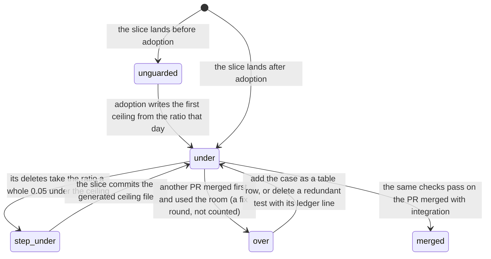
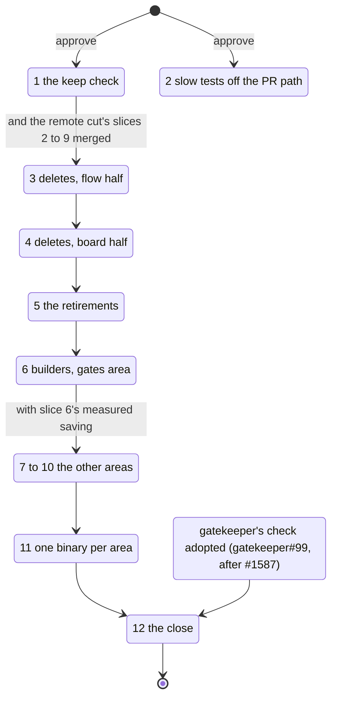

# test diet: who may call what, and the statecharts (#1760)

## Module boundaries

### Tests

```
 a test file  ──▶  common: World, Client, Repo, Log, Hook   ──▶  the crate's entry points
 (one area)        common: Fake, FakeShed (the scripted runner       drover::main_with (the CLI, in process)
                   and shed, behind the builders)                    serve::Server (a request, a stream)
                                                                     events: the log read back
```

| Module | May call | May not |
|---|---|---|
| A test file of an area | `common`'s builders; the crate's public entry points; a pure public function when no outer test shows its result (a table, with the reason in the PR body) | another area's files; a runner, an HTTP client, a git repo builder or a log reader of its own (slice 12's bans); the text of a src file |
| `common` | the crate's public API; `std` | assert anything: a builder builds and reads back, the test asserts |
| `sim/` | its own world and scheduler; `drover::sim::Hooks` | the builders of `common`: it simulates the world itself and stays apart |
| A soak target (`perf`, `soak`, `sim_soak`) | whatever a test file may; `sim_soak` the sim's modules | hold a test that is not ignored by default; exist without a smaller check of the same rule on the PR path |
| A table test | one arrange function per row | hide a row's name: the label is the old test's name and is printed on failure |

Layers of assertion, outermost first. A behaviour is asserted at the first layer that shows it, once:

1. the CLI verb or the drive pass: exit code, output, the events it logged;
2. an API route or a screen: the JSON the server builds;
3. a client: how the page, the terminal board or cooee draws that JSON. Those tests belong to the client
   (#1759, #1755, #1665), not to a second copy beside the server's;
4. a pure function: only as a table, only when layers 1 to 3 cannot show the value.

A second assertion of the same behaviour at an inner layer is a duplicate. A second assertion through another
transport that ends in the same handler is a duplicate; through a different handler it is not.

### Who owns which check

The diet builds one check, the keep job. The rest is gatekeeper's, read from its ADR (gatekeeper#99).

```
 a PR ─▶ gatekeeper: core/test-health   test lines over src lines under the ceiling; the ceiling only falls
      ─▶ gatekeeper: the timed test gate  a changed test under 2 s, the same result three times
      ─▶ gatekeeper: the coverage gate    the repo's line coverage not under the integration branch's
      ─▶ drover: the keep job             only when the diff removes a test: ledger, line-by-line cover
      ─▶ rev                              the ledger against the inventory; three `Kept-by` blocks re-run
```

| Who | May | May not |
|---|---|---|
| A diet slice | delete, merge and move tests; commit the ceiling file gatekeeper's `baseline` command writes; move a slow test's full size to a soak target | count test lines itself; edit or remove a ceiling file; add a test to gatekeeper's slow list; raise anything |
| The keep job | run the suite with coverage at the base and the head; read the PR body | block a PR that removes no test; judge the ratio or the total coverage (gatekeeper's) |
| gatekeeper's adoption issue for drover | write the first ceiling, the slow list, the `soak` key, the nightly gate | wait for the diet, or be waited for by any slice but the close |
| `drover cap`, the queue-wide view | stay as it is: the src cap only | |

The diet adds no state to drover: no event, no config key, no cache.

### CI files

One file per job area, none shared:

| File | What | Slice |
|---|---|---|
| a new workflow, `keep.yml` (a gate of drover's own once #1587 has moved CI) | the keep job, only when a PR's diff removes a `#[test]` | 1 |
| a new workflow, `soak.yml` (gatekeeper's nightly gate after adoption) | the three soak targets, in release | 2 |
| the release job of `.github/workflows/ci.yml` | runs the perf binary whole in release, with no list of test names, until adoption moves it to the nightly gate | 2 |
| `.github/workflows/sim.yml` | loses its metrics step with the tool | 5 |

## Statechart: a test in a diet slice

```mermaid
stateDiagram-v2
    [*] --> listed: the inventory gives it a verdict
    listed --> kept: keep
    listed --> row: table (its name becomes a row label)
    listed --> moved: merge (onto another fixture, name unchanged)
    listed --> ledgered: delete (a ledger line: kept by, or none with impl or dead)
    ledgered --> proven: dup only: the keeper fails when the behaviour is broken
    ledgered --> checked: impl or dead
    proven --> checked: the keep job finds the keeper and no lost cover
    row --> checked: the keep job finds the label and no lost cover
    moved --> checked: the keep job finds the same name
    checked --> gone: rev PASS, merge
    checked --> listed: lost cover: back to the lane; keep the test or name the line
    listed --> left: leaves with another issue (the diet never touches it)
```



A test whose inventory verdict turns out wrong in the lane's hands (the twin does not assert what the note says)
stays, and the PR body says so. The inventory is evidence, not an order.

## Statechart: a diet slice against gatekeeper's ceiling



The ceiling's own states (none, falling, resting at 1.00) are gatekeeper's and are drawn in its ADR.

## The order of the slices



Slice 2 blocks nothing by rule. By sense it lands before slice 6: the tests it leaves over 2 s are the ones the
area slices must deal with once gatekeeper's budget is on.
