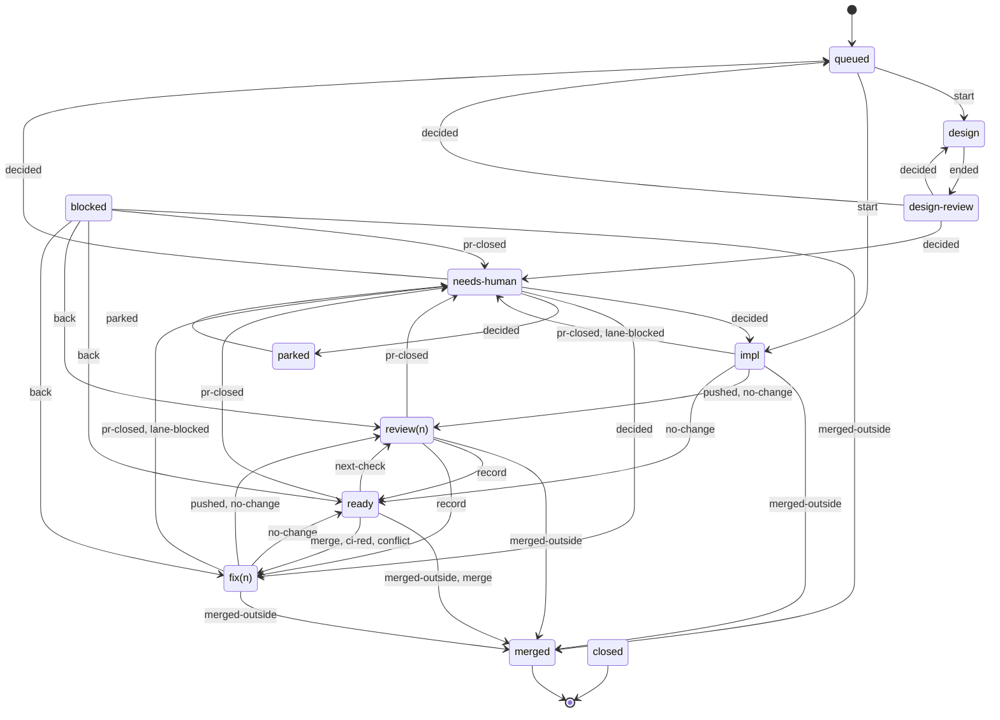
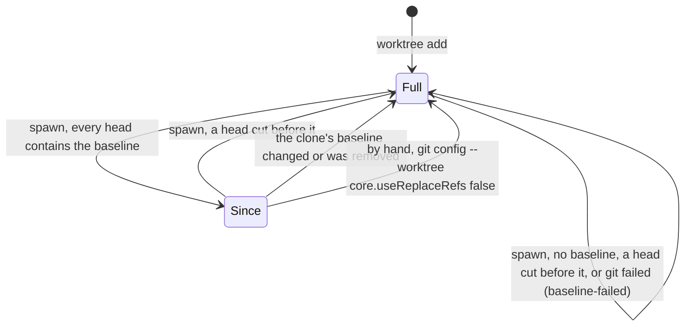

# Workflow

Generated by `drover diagram` from the code's tables (default `[limits]`); CI fails when this file differs.
`drover diagram --live [FLEET]` adds each state's issues (of FLEET, else every fleet) at the config's values.

## Issue states

## Timers and the drive pass

```mermaid
flowchart TD
    j0["dev.drover.tick: drover tick"] --> t0
    j1["dev.drover.fast: drover drive"] --> d0
    t0["check"] --> t1
    t1["drive"] --> t2
    t2["clean"] --> t3
    t3["trim"] --> t4
    t4["jobs"] --> t5
    t5["soak"] --> t6
    t6["hotspots"] --> t7
    t7["compact"]
    d0["look, repair"] --> d1
    d1["closed issues"] --> d2
    d2["PR reads, gates, steps"] --> d3
    d3["spawns"]
    t1 --> d0
    other["other timers: serve, hosts, store"]
    j0 -.- k_slow_secs(["slow_secs = 300"])
    j1 -.- k_fast_secs(["fast_secs = 60"])
    t0 -.- k_stall_minutes(["stall_minutes = 30"])
    t0 -.- k_ask_default_minutes(["ask_default_minutes = 30"])
    t0 -.- k_ask_waiting_minutes(["ask_waiting_minutes = 30"])
    t0 -.- k_ask_expire_hours(["ask_expire_hours = 24"])
    t0 -.- k_outbox_stale_minutes(["outbox_stale_minutes = 5"])
    t0 -.- k_acp_start_minutes(["acp_start_minutes = 3"])
    t0 -.- k_idle_reap_minutes(["idle_reap_minutes = 10"])
    t0 -.- k_done_close_minutes(["done_close_minutes = 5"])
    t0 -.- k_idle_merged_minutes(["idle_merged_minutes = 15"])
    t0 -.- k_token_refresh_minutes(["token_refresh_minutes = 30"])
    d0 -.- k_pass_max_secs(["pass_max_secs = 60"])
    d0 -.- k_ssh_quick_secs(["ssh_quick_secs = 5"])
    d0 -.- k_ssh_call_secs(["ssh_call_secs = 20"])
    d0 -.- k_shed_call_secs(["shed_call_secs = 30"])
    d0 -.- k_import_max_age_hours(["import_max_age_hours = 24"])
    d2 -.- k_webhook_poll_minutes(["webhook_poll_minutes = 10"])
    d2 -.- k_silent_minutes(["silent_minutes = 10"])
    d2 -.- k_ci_start_minutes(["ci_start_minutes = 10"])
    d2 -.- k_ci_stuck_minutes(["ci_stuck_minutes = 30"])
    d2 -.- k_gate_check_minutes(["gate_check_minutes = 30"])
    d2 -.- k_review_rounds(["review_rounds = 3"])
    d2 -.- k_update_rounds(["update_rounds = 3"])
    d2 -.- k_job_max(["job_max = 4"])
    d3 -.- k_max_parallel_spawns(["max_parallel_spawns = 6"])
    d3 -.- k_start_max(["start_max = 2"])
    d3 -.- k_start_release(["start_release = "started""])
    d3 -.- k_spawn_pending_max_secs(["spawn_pending_max_secs = 300"])
    d3 -.- k_admit_wait_secs(["admit_wait_secs = 5"])
    d3 -.- k_respawn_max(["respawn_max = 3"])
    d3 -.- k_respawn_window_minutes(["respawn_window_minutes = 60"])
    d3 -.- k_overflow_after_minutes(["overflow_after_minutes = 10"])
    other -.- k_overload_minutes(["overload_minutes = 10"])
    other -.- k_thread_resend_minutes(["thread_resend_minutes = 5"])
    other -.- k_transcript_days(["transcript_days = 30"])
    other -.- k_crash_wave_minutes(["crash_wave_minutes = 5"])
    other -.- k_runtime_down_minutes(["runtime_down_minutes = 30"])
    other -.- k_ssh_connect_secs(["ssh_connect_secs = 10"])
    other -.- k_ssh_retry_secs(["ssh_retry_secs = 1"])
    other -.- k_link_beat_secs(["link_beat_secs = 5"])
    other -.- k_link_stale_secs(["link_stale_secs = 20"])
    other -.- k_link_retry_max_secs(["link_retry_max_secs = 30"])
    other -.- k_link_poll_millis(["link_poll_millis = 500"])
    other -.- k_link_sample_secs(["link_sample_secs = 30"])
    other -.- k_link_down_minutes(["link_down_minutes = 5"])
    other -.- k_db_busy_secs(["db_busy_secs = 60"])
    other -.- k_db_retry_millis(["db_retry_millis = 10"])
    other -.- k_cloud_idle_stop_minutes(["cloud_idle_stop_minutes = 20"])
    other -.- k_notify_secs(["notify_secs = 15"])
    other -.- k_shed_read_millis(["shed_read_millis = 300"])
    other -.- k_proxy_connect_secs(["proxy_connect_secs = 1"])
    other -.- k_proxy_retry_secs(["proxy_retry_secs = 300"])
    other -.- k_service_call_secs(["service_call_secs = 2"])
    other -.- k_disk_probe_secs(["disk_probe_secs = 2"])
    other -.- k_disk_hung_secs(["disk_hung_secs = 6"])
    other -.- k_disk_sick_secs(["disk_sick_secs = 300"])
    other -.- k_disk_trust_secs(["disk_trust_secs = 60"])
    other -.- k_lane_read_secs(["lane_read_secs = 5"])
    other -.- k_guard_secs(["guard_secs = 180"])
    other -.- k_poll_millis(["poll_millis = 20"])
    other -.- k_hold_sample_secs(["hold_sample_secs = 10"])
    other -.- k_tick_beat_secs(["tick_beat_secs = 60"])
    other -.- k_orchestrator_idle_minutes(["orchestrator_idle_minutes = 30"])
    other -.- k_orchestrator_reply_minutes(["orchestrator_reply_minutes = 10"])
    other -.- k_orchestrator_change_minutes(["orchestrator_change_minutes = 30"])
    other -.- k_host_offline_minutes(["host_offline_minutes = 15"])
    other -.- k_host_down_secs(["host_down_secs = 60"])
    other -.- k_kick_max_secs(["kick_max_secs = 300"])
    other -.- k_serve_shed_secs(["serve_shed_secs = 5"])
    other -.- k_serve_remote_secs(["serve_remote_secs = 10"])
    other -.- k_serve_host_secs(["serve_host_secs = 10"])
    other -.- k_serve_heartbeat_secs(["serve_heartbeat_secs = 15"])
    other -.- k_serve_handover_secs(["serve_handover_secs = 300"])
    other -.- k_slo_api_minutes(["slo_api_minutes = 10"])
    other -.- k_slo_idle_minutes(["slo_idle_minutes = 20"])
    other -.- k_slo_tick_minutes(["slo_tick_minutes = 10"])
    other -.- k_slo_pass_minutes(["slo_pass_minutes = 5"])
    other -.- k_stall_restart_hours(["stall_restart_hours = 2"])
    other -.- k_self_update_wait_minutes(["self_update_wait_minutes = 45"])
    other -.- k_self_update_stage_secs(["self_update_stage_secs = 300"])
    other -.- k_act_minutes(["act_minutes = 10"])
    other -.- k_escalate_minutes(["escalate_minutes = 30"])
    other -.- k_start_minutes(["start_minutes = 10"])
    other -.- k_check_quiet_minutes(["check_quiet_minutes = 120"])
    other -.- k_host_wait_minutes(["host_wait_minutes = 30"])
    other -.- k_card_ttl_minutes(["card_ttl_minutes = 15"])
```

## History baseline

`drover baseline <fleet> [<sha>]` (the owner's; default: the integration tip) sets `[fleet.<f>] baseline`. A lane worktree whose branch contains it sees `git log`, `blame` and `shortlog` stop there: the baseline and the fork point of each older branch merged since are grafted parentless (`git replace --graft`). Nothing is rewritten: old shas still open with `git show`, GitHub, pushes and `refs/notes/why` are untouched, and drover's own git (gate, merge preview, `drover why`) runs with `--no-replace-objects`. The owner's checkout and a branch cut before the baseline keep full history; spawn prints `history: full (…)` for the latter.

Undo, at four sizes:

- one command: `git --no-replace-objects log`;
- one worktree, until its lane's next spawn: `git config --worktree core.useReplaceRefs false`;
- one clone, until drover's next spawn there: `git replace -d $(git replace -l)`;
- the fleet: remove `baseline` from `[fleet.<f>]`; each clone drops its grafts at its next spawn or preview.

## Compact: a repo's fresh start

Compact is the standalone `compact` binary (its own repo; install it on the PATH): one root commit before a cut, one commit per landed PR after it, an archive
in `<repo>-history`, and undo. Its README is the reference. Drover keeps only the glue:

- **Run.** `drover compact <fleet> <act>` runs `compact --repo <repo> --line <integration> --clone <clone> --lane
  [host:]<lane folder>… --fleet <each fleet on the repo> --saved <dir>/saved.tsv --dir <dir> <act>`, where `<dir>` is
  `<state dir>/compact/<repo>` and the act is compact's (`--cut <date|sha> [--dry-run | --thread <id>]`, `--undo
  [--dry-run | --thread <id>]`, `--reset`). A lane runs only `--dry-run`.
- **Cards.** With `--thread <id>`, compact posts its own run cards (`drover card post`): `compact … --push <new tip>`
  for every ref but `main` and, when `main` moves, `compact … --main --push <main's new tip>`. Each runs only inside
  its approved card. Pause the fleet first.
- **Records.** The log is never edited. Drover lists its saved commit ids (`reroot::SAVED`; a sha-named field it
  leaves alone is in `reroot::KEPT` with why) in `saved.tsv`. After the push, compact writes `moved.json`, and after
  an undo `undone`; the next `drover compact` or drive pass logs them once as `compacted` (one per fleet, one per
  issue with ids in both histories) and `compact-undone`. Those bridge the two histories for `drover why` and
  hotspots, and drive, spawn and merge refuse `OLD_ROOT` for a clone or PR head that is not on the new root.
- **Guard.** CI's `every_saved_sha_field_is_in_compacts_list` fails a PR that writes a new `*_sha` field in neither
  list (crates/cli/tests/compact.rs).
