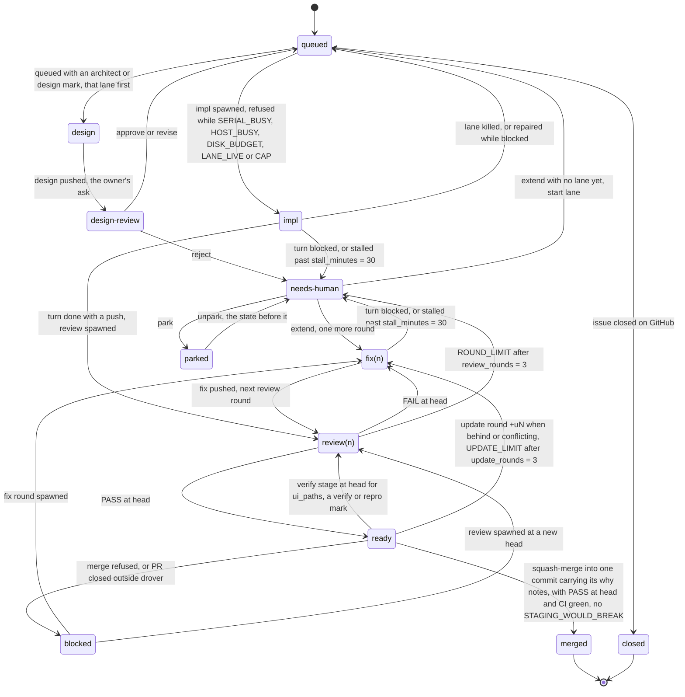

# Workflow

Generated by `drover diagram` from the code's tables (default `[limits]`); CI fails when this file differs.
`drover diagram --live [FLEET]` adds each state's issues (of FLEET, else every fleet) at the config's values.

## Issue states

## Timers and the drive pass

```mermaid
flowchart TD
    j0["dev.drover.tick: drover tick"] --> t0
    j1["dev.drover.fast: drover drive --fast"] --> d0
    t0["check"] --> t1
    t1["drive"] --> t2
    t2["clean"] --> t3
    t3["trim"] --> t4
    t4["lesson"] --> t5
    t5["hotspots"] --> t6
    t6["compact"]
    d0["read log, host sample"] --> d1
    d1["disk budget"] --> d2
    d2["roots, redeliver"] --> d3
    d3["look, orphans"] --> d4
    d4["repair, outbox"] --> d5
    d5["spawns"] --> d6
    d6["PR reads, gates, steps"] --> d7
    d7["backlog"]
    t1 --> d0
    other["other timers: serve, hosts, store"]
    j0 -.- k_slow_secs(["slow_secs = 300"])
    j1 -.- k_fast_secs(["fast_secs = 60"])
    t0 -.- k_stall_minutes(["stall_minutes = 30"])
    t0 -.- k_ask_default_minutes(["ask_default_minutes = 30"])
    t0 -.- k_ask_waiting_minutes(["ask_waiting_minutes = 30"])
    t0 -.- k_ask_expire_hours(["ask_expire_hours = 24"])
    t0 -.- k_outbox_stale_minutes(["outbox_stale_minutes = 5"])
    t0 -.- k_acp_start_minutes(["acp_start_minutes = 3"])
    t0 -.- k_idle_reap_minutes(["idle_reap_minutes = 10"])
    t0 -.- k_done_close_minutes(["done_close_minutes = 5"])
    t0 -.- k_idle_merged_minutes(["idle_merged_minutes = 15"])
    t0 -.- k_token_refresh_minutes(["token_refresh_minutes = 30"])
    t1 -.- k_pass_max_secs(["pass_max_secs = 120"])
    d1 -.- k_shed_read_millis(["shed_read_millis = 300"])
    d1 -.- k_worktree_budget_gb(["worktree_budget_gb = 25.0"])
    d1 -.- k_build_budget_gb(["build_budget_gb = 20.0"])
    d2 -.- k_host_offline_minutes(["host_offline_minutes = 15"])
    d3 -.- k_ssh_quick_secs(["ssh_quick_secs = 5"])
    d3 -.- k_ssh_call_secs(["ssh_call_secs = 20"])
    d3 -.- k_import_max_age_hours(["import_max_age_hours = 24"])
    d5 -.- k_max_parallel_spawns(["max_parallel_spawns = 6"])
    d5 -.- k_start_max(["start_max = 2"])
    d5 -.- k_start_release(["start_release = "started""])
    d5 -.- k_spawn_pending_max_secs(["spawn_pending_max_secs = 300"])
    d5 -.- k_respawn_max(["respawn_max = 3"])
    d5 -.- k_respawn_window_minutes(["respawn_window_minutes = 60"])
    d5 -.- k_overflow_after_minutes(["overflow_after_minutes = 10"])
    d6 -.- k_webhook_poll_minutes(["webhook_poll_minutes = 10"])
    d6 -.- k_silent_minutes(["silent_minutes = 10"])
    d6 -.- k_ci_start_minutes(["ci_start_minutes = 10"])
    d6 -.- k_gate_check_minutes(["gate_check_minutes = 30"])
    d6 -.- k_review_rounds(["review_rounds = 3"])
    d6 -.- k_update_rounds(["update_rounds = 3"])
    other -.- k_overload_minutes(["overload_minutes = 10"])
    other -.- k_transcript_days(["transcript_days = 30"])
    other -.- k_runtime_down_minutes(["runtime_down_minutes = 30"])
    other -.- k_ssh_connect_secs(["ssh_connect_secs = 10"])
    other -.- k_db_busy_secs(["db_busy_secs = 60"])
    other -.- k_db_retry_millis(["db_retry_millis = 10"])
    other -.- k_cloud_idle_stop_minutes(["cloud_idle_stop_minutes = 20"])
    other -.- k_notify_secs(["notify_secs = 15"])
    other -.- k_proxy_connect_secs(["proxy_connect_secs = 1"])
    other -.- k_service_call_secs(["service_call_secs = 2"])
    other -.- k_disk_probe_secs(["disk_probe_secs = 2"])
    other -.- k_disk_sick_secs(["disk_sick_secs = 300"])
    other -.- k_disk_trust_secs(["disk_trust_secs = 60"])
    other -.- k_lane_read_secs(["lane_read_secs = 5"])
    other -.- k_poll_millis(["poll_millis = 20"])
    other -.- k_tick_beat_secs(["tick_beat_secs = 60"])
    other -.- k_orchestrator_idle_minutes(["orchestrator_idle_minutes = 30"])
    other -.- k_orchestrator_change_minutes(["orchestrator_change_minutes = 30"])
    other -.- k_serve_shed_secs(["serve_shed_secs = 5"])
    other -.- k_serve_remote_secs(["serve_remote_secs = 10"])
    other -.- k_serve_host_secs(["serve_host_secs = 10"])
    other -.- k_serve_heartbeat_secs(["serve_heartbeat_secs = 15"])
    other -.- k_serve_handover_secs(["serve_handover_secs = 300"])
    other -.- k_slo_api_minutes(["slo_api_minutes = 10"])
    other -.- k_slo_idle_minutes(["slo_idle_minutes = 20"])
    other -.- k_slo_tick_minutes(["slo_tick_minutes = 10"])
    other -.- k_slo_pass_minutes(["slo_pass_minutes = 30"])
```

## Compact: a repo's fresh start

Compact is a feature for any fleet: the repo, its integration branch, `main` and the archive
(`<repo>-history`) all come from the fleet. `drover compact <fleet> --cut <date|sha>` replaces the fleet's integration line with one root commit (the
cut's exact tree, message `<repo>: initial (history before <date> in <owner>/<repo>-history)`) and one commit per
landed PR after it, each with the old commit's tree, message, author and date. Every other branch and notes ref is
carried with its files unchanged: an open PR's commits are copied onto their true base; a branch that last met the
line before the cut is carried detached; a branch fully merged is deleted (the archive keeps it). Nothing is
rebased or replayed, and every new tip's tree is checked equal to its old one (`COMPACT_TREE`).

- **Dry run.** `--dry-run` mirrors origin into `<state dir>/compact/<repo>/old.git`, writes `plan.json` and
  `compact-map.tsv` (old sha, new sha, `same`/`held`/`root`) and prints the old → new commit counts, the root,
  each PR commit, the open PRs to carry, the event records to remap and the readiness checks. It pushes nothing.
  It is the only form a lane may run.
- **Cards.** `--thread <id>` posts a run card for `drover compact <fleet> --push <new tip>` (every ref but
  `main`) and, when `main` moves, a second card for `drover compact <fleet> --main --push <main's new tip>`. Each is
  approved on its own (`--sha`); `--push` runs only inside its approved card (`COMPACT_UNAPPROVED`), so the line's
  card never pushes `main`. The fleet must be paused, no check lane working, every lane
  folder clean and pushed, no open PR from a fork or left detached, force pushes allowed (`COMPACT_NOT_READY`).
- **Main.** `main` is rewritten like any branch, but its new tip's tree must equal its old one and it is never
  deleted, else the cut aborts before any push (`COMPACT_TREE`). Its card runs after the line's (`COMPACT_NOT_READY`
  before), pushes `main` alone with `--force-with-lease` on its old tip, and its blast says the push may fire the
  repo's main-merge workflows (a prod deploy, migrations).
- **Archive.** The approved run first pushes every old branch, tag, note and PR head (as `pull/<n>`) to the
  private `<owner>/<repo>-history`, reads it back, and adds the plan and map on its `drover-compact` branch
  (`COMPACT_ARCHIVE` if it is public or misses a ref).
- **Push.** Then one atomic push moves every ref of origin but `main`, each with a lease on its old value (`COMPACT_MOVED`
  if one moved since the plan). The log is never edited: one `compacted` record per fleet and per issue with ids in
  both histories bridges them for `drover why` and hotspots; a line older than the cut is answered from the
  local archive copy. Open PR bodies get their new head ids; their old PASS does not carry, so each gets one fresh
  review. The fleet's clone and lane folders are reset (`--reset` repeats it); drive, spawn and merge refuse
  `OLD_ROOT` for a clone or PR head that is not on the new root.
- **Undo.** `drover compact <fleet> --undo --thread <id>` posts a card for `--undo --push <old tip>`, which puts
  every ref but `main` back from the scratch copy (else the archive) while all are still where compact put them,
  and logs `compact-undone`; and, when `main` moved, its own card for `--undo --main --push <main's old tip>`.
  Resuming the fleet ends that window.
- **Guard.** Compact remaps stored ids through one list, `compact::SAVED` (record kind, field); a sha-named field
  it leaves alone is in `compact::KEPT` with why. CI's `every_saved_sha_field_is_in_compacts_list` fails a PR that
  writes a new `*_sha` field in neither, and the sim fixture (merges, why notes, a PASS, an open PR, `main`; compact,
  then undo) runs in the normal test step (crates/cli/tests/compact.rs).
